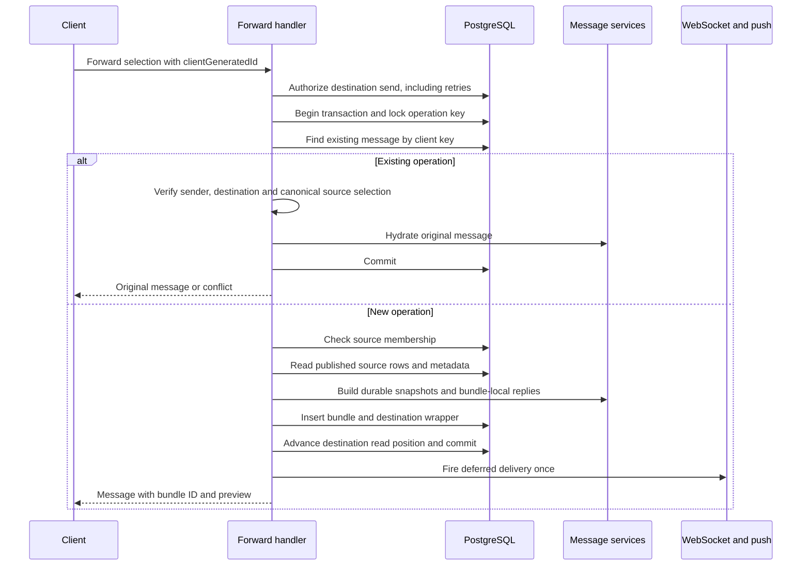
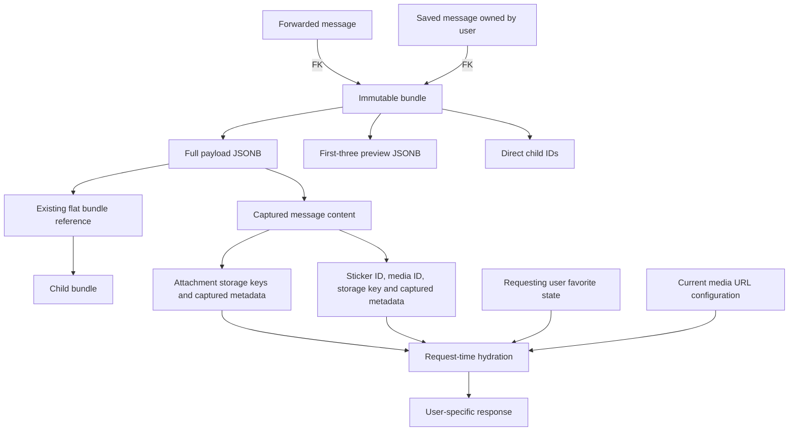
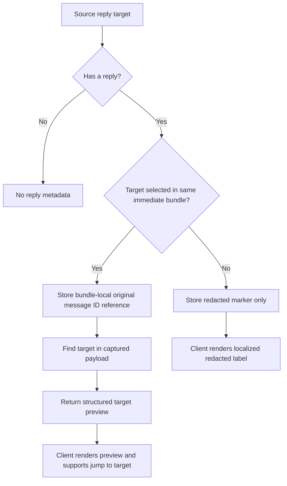

# Forwarded messages

Backend design and decisions, updated 2026-10-22. PWA presentation is outside this backend change.

## Contract

- Merge 2–100 distinct, nondeleted messages from one source chat. A selection of one uses the single-message endpoint. Destinations may be a chat timeline or a thread via `threadId`.
- Sources are ordered by message ID, not request-array order. System and invite messages are excluded.
- Both forwarding request bodies accept `allowPlaceholders` (default `false`). After user confirmation, `true` permits pending audio and excessive bundle nesting to be captured as immutable placeholders. Without confirmation these cases still return `400`; final audio states (`done` or `failed`) are forwarded normally. Successful retries return the stored result without rebuilding content.
- Require `clientGeneratedId` alongside `sourceChatId` and `messageIds`.
- Repeating a successful operation with the same authenticated sender, destination and canonical source selection returns the original message. Reusing its key for different content returns `409`.
- Retries do not rebuild snapshots, insert another bundle, advance read state again, or repeat delivery effects.
- New forwards atomically advance the sender's unread and read-receipt cursors; DM receipt invalidations are broadcast after commit.
- Forwarding accepts an optional destination `threadId`; destination thread authorization and ordinary thread-send side effects apply. Captions and reply targets are not supported.
- Source membership and normal destination send authorization apply to creation. Blocked/unfriended DMs cannot receive forwards.
- Each bundle is immutable. Message rows and saved-message rows hold bundle foreign keys.
- A flat bundle may be included by reference in a new bundle. A bundle already containing children becomes a placeholder when merged with confirmed degradation; it is never recursively embedded. Single-message forwarding reuses an existing bundle unchanged, regardless of its children.

## Confirmed placeholder contract

The frontend must not allow selection of local messages that have not been uploaded and acknowledged with a server message ID. Forwarding only accepts server IDs. Persisted audio still processing can be selected; the client uses the acknowledged ID even before its publication event.

The client asks for confirmation when the selection requires replacement, then sends `allowPlaceholders: true` to either the single or merged endpoint. The server decides which sources need replacement from current database state, not client-provided content. If processing completed before submission, it captures the now-available audio normally. The flag does not relax source membership, destination authorization, deletion checks, system/invite exclusions, selection size, or duplicate-ID validation.

Published sources remain readable to source-chat members. The sole unpublished exception is an authenticated user's own audio in `none`/`pending` transcode state, and it can only produce a placeholder after confirmation. Other users' unpublished messages, unpublished non-audio sources, deleted rows and nonexistent IDs remain unavailable. Source queries are still bounded by at most 100 primary-key IDs; no new index is required.

Placeholder responses use `messageType: "placeholder"`; the existing `message` field contains one of these reason codes:

| Value | Display | Trigger |
|---|---|---|
| `pendingAudio` | `[待转码语音]` | Audio whose transcode status is not final |
| `nestedForward` | `[聊天记录]` | Merging a card whose bundle already has children |

A placeholder has a distinct message type, for example `{ "messageType": "placeholder", "message": "pendingAudio" }`. Clients render a localized label only for this type and offer no playback or child-record action for it. Ordinary `text` messages containing `pendingAudio`, `nestedForward`, or the translated labels remain literal user text. Generic message-create APIs reject client-supplied `placeholder` types, and placeholder messages cannot be edited into text. The send pipeline accepts only the documented reason codes and rejects media or bundle references for placeholders. It has no attachments, sticker, mentions, bundle reference or child preview. Merged records retain the source sender, timestamp, original IDs, order and bundle-local reply relationships; replies to these records use the same placeholder preview. A replaced card contributes no child bundle ID, so it grants no access to the discarded bundle. Normal flat cards remain navigable.

Single pending-audio forwarding produces one immediately published placeholder message through the single-message API, with ordinary flattened forwarding attribution and no copied media. Single forwarding of a normal history card still reuses its bundle without replacement or a new nesting level. A single forwarded placeholder remains a placeholder on subsequent single or merged forwarding, even after the original audio finishes. It does not require another confirmation just to copy an existing placeholder.

No new database columns or response fields are needed. Messages use the existing `message_type`/`message` columns; saved messages use `snapshot_message_type`/`snapshot_message`; forwarded payload/preview JSON uses its existing type and text fields. Message responses, reply/thread previews, forwarded detail/preview responses, saved responses, and structured push previews retain both the placeholder type and the reason code. No localized display text is stored in snapshots. Fallback notification text follows the existing server-side English notification convention, while structured push data keeps the code for client localization. APNs fallback bodies also render a label rather than exposing the code.

Snapshots never auto-upgrade when the source becomes available. Retrying an already successful operation returns the same result even if `allowPlaceholders` or transcode status changed. Single-forward retries retain their existing live-source-access requirement; merged retries retain their existing source-independent reconciliation. Clients must reuse the same `clientGeneratedId` after a lost response.

## Creation and retry flow

A transaction-scoped operation lock serializes concurrent requests using the same retry key. Existing-message uniqueness remains enforced by the database. The operation-key lock is not a source-content lock.
Retries still require destination send authorization, but do not require the source message to remain visible or source membership to remain present. Conflict paths roll back the transaction.

`services/forwarding.rs` owns selection validation, retry reconciliation, source authorization, and bundle insertion. The HTTP handler owns transaction boundaries, sending, read-state advancement, and post-commit delivery. Capture batches only attachments, sticker snapshots, and referenced previews; it does not hydrate source timelines or query reactions.

**Accepted tradeoff:** source text and dependent metadata are read separately at ordinary database isolation. Concurrent editing can yield a mixed-version capture. No source locking or repeatable-read redesign is included, per the explicit product decision.

## Durable snapshots and hydration

Stored sticker data is not a `MessageStickerResponse`. Public URLs and `isFavorited` are response data, not historical content. At read time:

1. Generate media URLs from stored object keys and current media configuration.
2. Batch-load favorite sticker IDs for the requesting user, not the original sender or forwarder.
3. Hydrate sender and mention profiles by UID.
4. Resolve internal reply previews from the same bundle's captured items.

This applies to both chat and saved-forward detail endpoints. Captured sticker metadata preserves the forwarded content without requiring a live sticker row to reconstruct it. Reply previews use the same captured content rather than fetching the original source message again.

Timeline hydration reads only compact preview JSON/count/child IDs in a batched query. Stored previews contain display fields, attachment kinds, and sticker emoji—not storage keys, file details, full sticker metadata, or replies. Full payloads are loaded on explicit detail requests. Child access projects only the authorized root's child IDs before loading the requested target. Preview size is bounded by item count (three), not by serialized byte count. Preview query/deserialization failures are logged explicitly rather than silently treated as missing metadata.

## Reply contract

- **No reply:** no reply metadata.
- **Internal:** retain a reference to a selected item in the same immediate bundle; return a structured preview derived from that target snapshot. The client renders the preview and can locate the target within the bundle.
- **External:** retain only a redacted marker. Do not store or return target IDs, text, sender identity, or mentions. The client displays localized `[redacted]`.
- Do not resolve references across child bundles or use the source chat as a fallback.
- Snapshotting an existing forwarded wrapper uses the same selection boundary; child bundles keep their own already-captured reply boundaries.

The backend supplies structured data, not HTML or a pre-rendered localized string.

## Authorization and saved access

| Read path | Authority |
|---|---|
| Chat root details | Current chat membership plus live, published forwarded wrapper in that chat |
| Chat child details | Same root checks, then root ID or direct child ID must match |
| Saved root details | Saved row selected by both saved ID and authenticated UID |
| Saved child details | Same saved ownership check, then root ID or direct child ID must match |

Knowing a bundle ID alone is not authorization. Saved details intentionally survive original-message deletion and loss of source-chat membership. The saved owner is also the hydration viewer, so sticker favorite state is adapted to that user.

Routes, relative to the API mount:

- `POST /chats/{chat_id}/messages/forward` (merged, 2–100 IDs)
- `POST /chats/{chat_id}/messages/{message_id}/forward` (single)
- `GET /chats/{chat_id}/messages/{message_id}/forwarded-messages`
- `GET /chats/{chat_id}/messages/{message_id}/forwarded-bundles/{bundle_id}/messages`
- `PUT /saved-messages/{message_id}`
- `GET /saved-messages/{saved_message_id}/forwarded-messages`
- `GET /saved-messages/{saved_message_id}/forwarded-bundles/{bundle_id}/messages`

IDs are serialized as strings. Detail totals count immediate items, not recursively expanded leaves.

## Migration and local-development reset

Nothing in this feature has been deployed. The intermediate forwarding migrations are replaced by one final-schema migration:

`backend/migrations/2026-10-21-000002-0000_add_forwarded_bundles`

It adds the forwarded enum value, bundle table (including child IDs and preview), message bundle reference, and saved-message bundle reference. There is no temporary inline-payload column, conversion/backfill, or deployed-data compatibility path.

The migration sorts after `main`'s `2026-10-21-000001-0000_cleanup_reaction_watermark` migration.

**Local databases that applied the old migrations are not automatically upgraded.** Before switching history, back up any valuable local data and revert the old feature migrations using the old checkout, or recreate a disposable development database. Do not merely remove entries from Diesel's migration ledger: the physical schema must match. Rollback retains the unused PostgreSQL enum value, as PostgreSQL does not support dropping an enum value in place.

The compact preview format is also a clean cutover: earlier local forwarding bundles that stored full payload items as previews are not backfilled. Recreate disposable development data before using this checkout with those bundles; preserve valuable data before any reset.

History cleanup preserves the original feature author separately from integration and subsequent correctness work. Backup branches retain the pre-rewrite history. No remote force-push is part of this change.

The migration `backend/migrations/2026-10-22-121835-0000_add_placeholder_message_type` adds `placeholder` to the existing PostgreSQL `message_type` enum. It adds no columns, rewrites no rows, and changes no indexes. The earlier, unapplied column-based migration has been removed. Apply the enum migration before deploying this backend; no database migration was executed as part of this task. PostgreSQL cannot remove an enum value in place, so rollback retains the value and existing placeholder data. Clients must support the new type before enabling confirmed placeholder forwarding.

## Remaining product limitations

- No forwarding directly from a saved item after source access is lost.
- No selecting individual embedded items without access to their original messages.
- No deeper bundle nesting: merged forwarding uses confirmed placeholders for already-nested cards; single forwarding reuses the existing bundle.
- Search indexes text messages, not forwarded snapshots.
- Deleting source content does not recall existing forwarded/saved copies.
- Child references are application-maintained arrays, not foreign keys. Future garbage collection must trace message/saved roots and child edges, including media referenced in snapshots.
- Ordinary source deletion soft-deletes rows; it does not currently delete retained object-storage media.

## Verification targets

- Concurrent same-key requests create one bundle and wrapper; retry after source deletion returns the same result.
- Changed selection or destination with the same key returns `409`.
- External replies expose no target identity/content; internal replies use captured target content.
- Sticker snapshot JSON contains object keys and IDs, not URL/favorite state.
- Two viewers receive their respective favorite state for the same saved/chat bundle.
- New media URL configuration affects existing snapshot response URLs.
- Saved root/child reads reject another owner's saved ID and unrelated child IDs.
- Consolidated migration runs on a clean PostgreSQL database and supports rollback/reapply.

### Executed checks

- `cargo test --locked`: 253 tests passed.
- `cargo clippy --locked --all-targets -- -D warnings`: passed.
- `cargo build --locked`: passed.
- Disposable PostgreSQL 17: all migrations applied; final forwarding migration rolled back and reapplied successfully.
- Live authenticated API: four concurrent forwards returned one persisted message/bundle; changed selection/destination returned `409`; retry after deleting source rows and removing source membership returned the original ID.
- Live chat/saved details: internal preview and external redaction, per-viewer sticker favorites, saved-owner rejection, nested child access after chat departure/root soft deletion, and unrelated-child rejection all passed.
- Restarting the isolated API with a new media base URL changed URLs for previously saved sticker snapshots.

Migration schema generation reports the existing Diesel distinction between `Array<Int8>` and generated `Array<Nullable<Int8>>` for `child_bundle_ids`; migration execution/rollback was checked independently using a migration-only config. No local development or shared database was migrated.

### Pre-fix rebase verification (2026-10-21)

- Rebased onto `main`; re-dated the forwarding migration after its latest migration.
- Disposable PostgreSQL 18: all migrations applied in order; the forwarding migration rolled back and reapplied successfully.
- `cargo build --locked` and `cargo clippy --locked --all-targets -- -D warnings`: passed.
- `cargo test --locked`: 289 passed, two OpenAPI contract tests failed. The new chat forwarding routes describe chat IDs as integers and reference the unregistered `uid_header` security scheme.
- Live isolated API: concurrent retry deduplication, changed-selection conflict, source-membership enforcement, anonymous/outsider read rejection, system/invite/unpublished rejection, text/file/audio/sticker snapshots, internal reply previews, external reply redaction, and per-viewer sticker favorites passed.
- Live isolated API: saved ownership, reachable/unrelated child checks, nesting-depth rejection, saved root/child access after departure and wrapper deletion, retry after source deletion/departure, and DM retry rejection after unfriending passed.
- Confirmed a DM read-receipt regression: forwarding advances `last_read_message_id` but leaves `last_read_receipt_message_id` unchanged; an ordinary send advances the receipt cursor.
- These findings preceded the fixes verified below. No shared or local-development database was migrated; media checks validated generated URLs and metadata, not object downloads or playback.

### Review fixes and verification (2026-10-21)

- DM forwards advance unread and receipt cursors atomically and send post-commit receipt invalidations only on creation. Live WebSocket/API checks observed one receipt event and the expected peer-visible cursor; a retry returned the same message without another event or cursor advancement.
- All three chat forwarding routes document string chat IDs and bearer JWT authentication. The existing global OpenAPI contract tests and the live API document passed.
- Capture bypasses timeline hydration; root reads share authorization; child reads fetch root reachability metadata without its payload; previews store compact display data. Forward hydration takes narrow media/avatar dependencies. Inactive debug code, duplicate wrapper-text construction, and obsolete test scaffolding were removed.
- `cargo test --locked`: 288 passed. `cargo build --locked` and `cargo clippy --locked --all-targets -- -D warnings`: passed.
- Live isolated PostgreSQL 18/API checks passed: four-way concurrent retries; selection/destination conflicts; unauthorized source and anonymous/outsider read denials; invalid selections and system/invite/unpublished rejection; text, mentions, internal/external replies, ordered/nondeleted file attachments, audio metadata, and per-viewer sticker favorites.
- Saved root/child access remained valid after source/media soft deletion, wrapper deletion, and chat departure. Wrong saved owner, unrelated child, excessive nesting, deleted live wrapper, ordinary-send forwarded-type spoofing, and DM retry after unfriending were rejected.
- Query statistics confirmed child access selects only the root's child-ID array before loading target details. A malformed-preview read emitted an error identifying the failing bundle.
- A single local before/after capture run selected 100 messages with 500,000 reactions: baseline fetched all 500,000 reactor rows and took 1540.6 ms; the fixed request issued no reaction SELECTs and took 89.6 ms. This synthetic sample demonstrates removal of the query amplification, not production throughput or a controlled benchmark.
- No shared database was modified. Media checks covered metadata/URLs, not object downloads or audio playback.

### Placeholder implementation (2026-10-22)

The implementation uses the existing message type and content fields, with the new `placeholder` enum value and the `allowPlaceholders` forwarding option. Per request, no tests, builds, checks or database migrations were executed for this change. The PWA implements confirmation, localized placeholder rendering, and local-selection gating; its client contract is documented in [PWA requirements](../pwa/docs/requirements.md#消息转发) and [data flow](../pwa/docs/data-flow.md#转发与聊天记录).
