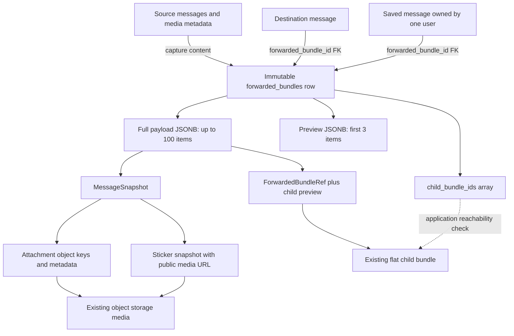
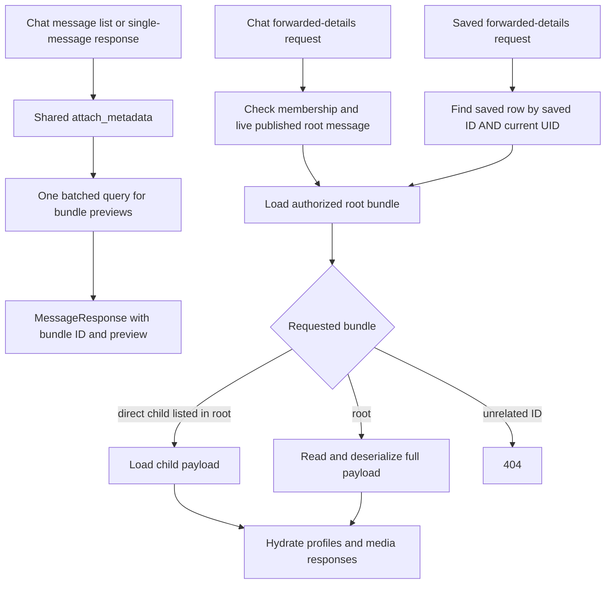

# Forwarded messages: architecture and functional review

Review date: 2026-09-24. Scope: current backend working tree, including the recent correctness fixes—not only the branch diff. Flutter and PWA UI behavior are outside this review. This document describes implemented behavior; recommendations below are not implemented by this review.

## Summary

The immutable-bundle design is appropriate: ordinary messages reference a bundle, timeline reads load its compact preview, and explicit details requests load the full payload. Saved messages retain their own reference and authorization context. Keep this architecture.

Remaining actionable holes are retry duplication, inconsistent snapshots during concurrent edits, and two sticker response issues. There are also **two conditional upgrade risks** for databases containing earlier forwarding formats: lost inline payloads and inaccessible nested bundles. Several intentional limitations need product sign-off, especially forwarding already-nested bundles and forwarding from saved items.

## Creation flow

```mermaid
sequenceDiagram
    participant C as Client
    participant H as Forward handler
    participant S as Message services
    participant DB as PostgreSQL
    participant W as WebSocket and push
    C->>H: POST /chats/{destination}/messages/forward
    Note over C,H: sourceChatId and messageIds; no client retry key
    H->>DB: Check source membership
    H->>S: Authorize destination send
    S->>DB: Check membership and DM friendship/block policy
    H->>DB: Read 1-100 published, nondeleted source messages
    Note over H,DB: Ascending message ID order; source capture is outside transaction
    H->>S: Hydrate sources and build immutable snapshots
    S->>DB: Load attachments, stickers, profiles and child previews
    Note over H,S: Reject system/invite sources and bundles already containing child bundles
    H->>DB: BEGIN
    H->>DB: Insert bundle payload, first-three preview, child IDs
    H->>S: Send top-level forwarded wrapper
    S->>DB: Insert message referencing bundle; prepare delivery effects
    H->>DB: Mark destination read and COMMIT
    H->>W: Fire deferred delivery effects
    H-->>C: 201 MessageResponse with bundle ID and preview
```

The transaction protects bundle creation, destination message creation, and read-position advancement. It does **not** currently give source capture a consistent database snapshot. Delivery happens after commit and is separate from the database transaction.

## Stored data and ownership



- Full payload items are tagged `messageSnapshot` or `forwardedBundleRef`.
- Content, original IDs, timestamps, reply previews, and attachment metadata are captured. Sender and mention display profiles are looked up by UID at read time; this is not a historical profile snapshot.
- Attachments retain object keys and regenerate public URLs on read. Sticker snapshots currently retain their public URLs instead; see F4.
- Bundles containing child references cannot themselves be nested again. The graph is bounded to a root and direct child bundles.
- `child_bundle_ids` is an application-maintained array, not a foreign-key relation. Message and saved-message root references are foreign keys.
- Soft-deleting the source message does not erase the captured content. The inspected source-delete and sticker-pack-delete paths do not delete its underlying storage object. This review did not find a source-delete-induced broken-media path.

## Read paths and authorization



Knowing a bundle ID alone is not an authorization grant. Chat details require a visible wrapper in a chat the user belongs to; saved details require ownership of the saved row. Saved access intentionally survives leaving the source chat or deleting its message. A removed chat wrapper cannot be used to read details through the chat route; another valid wrapper or saved reference can still grant access.

### API inventory

Paths are relative to the backend API mount.

| Operation | Route / contract |
|---|---|
| Forward a selection | `POST /chats/{chat_id}/messages/forward`, body `{ sourceChatId, messageIds }` |
| Root details in a chat | `GET /chats/{chat_id}/messages/{message_id}/forwarded-messages` |
| Child details in a chat | `GET /chats/{chat_id}/messages/{message_id}/forwarded-bundles/{bundle_id}/messages` |
| Save a visible message | `PUT /saved-messages/{message_id}` |
| Saved root details | `GET /saved-messages/{saved_message_id}/forwarded-messages` |
| Saved child details | `GET /saved-messages/{saved_message_id}/forwarded-bundles/{bundle_id}/messages` |

Message/bundle IDs are serialized as strings. `item_count`/response `total` count immediate entries, not recursively expanded leaf messages. Details return the entire bounded bundle; there is no detail pagination.

## Findings

### F1 — P2: retries create duplicate messages and bundles

**Evidence:** [Forward request DTO](../backend/src/handlers/chats/mod.rs#L78-L87) has no idempotency key; [the handler](../backend/src/handlers/chats/messages.rs#L783-L799) generates a fresh `client_generated_id` on every request.

**Scenario:** the server commits a forward, but the client loses the response and retries the same request. Each request creates a distinct bundle and wrapper, and each fires delivery effects. The ordinary send service's duplicate detection cannot help because the UUID changes.

**Recommendation:** accept a client-generated operation ID, validate duplicate payload equivalence, and return the original result without creating another bundle or delivering again. Persist sufficient request identity to distinguish a retry from reuse of the same key with a different selection/destination.

### F2 — P2: concurrent editing can capture a source version that never existed

**Evidence:** [Source rows and metadata are read before BEGIN](../backend/src/handlers/chats/messages.rs#L703-L760). [Editing](../backend/src/handlers/chats/messages.rs#L1177-L1252) locks the message and updates attachment selection and text together in its own transaction.

**Scenario:** forwarding reads the old text; an edit commits new text and new attachment selection; forwarding then hydrates the new attachments. The immutable result contains old text plus new attachments rather than either actual version. Concurrent deletion can similarly remove metadata between the reads.

**Recommendation:** capture the source content and dependent metadata within a deliberate consistency boundary, such as a suitable snapshot transaction or coordinated source-row locks. Simply moving BEGIN earlier under default READ COMMITTED isolation is not sufficient by itself. Do not hold source locks while delivering WebSocket/push effects.

### F3 — P2: forwarded sticker favorite state is always false

**Evidence:** [Forwarded detail rendering](../backend/src/services/messages.rs#L854-L872) explicitly sets `sticker.is_favorited = false`; the detail conversion does not take a requesting UID for favorite lookup.

**Scenario:** the requesting user has already favorited the sticker. Normal messages show that state, but the forwarded-details API says it is not favorited. The snapshot correctly avoids copying another user's preferences, but the response never restores the current user's state.

**Recommendation:** retain viewer-neutral stored data, then batch-load the requesting user's favorite IDs while hydrating details. Cover both chat and saved-detail endpoints.

### F4 — P2: forwarded sticker URLs are not durable across media endpoint changes

**Evidence:** [Snapshot construction](../backend/src/services/messages.rs#L537-L552) saves the complete `MessageStickerResponse`, including its public URL. [MediaStore](../backend/src/services/media.rs#L55-L63) derives URLs from current configuration, but that derivation is not reapplied to forwarded sticker snapshots.

**Scenario:** the media base URL or bucket endpoint changes and the old address is retired. Normal sticker messages and key-backed forwarded attachments can use the new location; existing forwarded stickers still return the obsolete URL.

**Recommendation:** snapshot sticker storage keys and media metadata and construct public URLs at read time. Plan a migration/recovery strategy for existing URL-only snapshots; do not assume arbitrary URLs can be reversed into keys.

### F5 — P1 if legacy inline-payload data was deployed: migration discards forwarded content

**Evidence:** [The bundle migration](../backend/migrations/2026-09-23-000002-0000_add_forwarded_bundles/up.sql) adds nullable bundle IDs without transferring inline payloads. [The next migration](../backend/migrations/2026-09-23-000003-0000_drop_forwarded_messages_payload/up.sql) drops `forwarded_messages_payload`. [The later saved-reference backfill](../backend/migrations/2026-09-24-060446-0000_add_saved_forwarded_bundle_reference/up.sql) can only recover rows whose source message already has a bundle ID.

**Scenario:** a database contains forwarded messages created by the intermediate inline-payload implementation. Applying these migrations removes their only stored content, leaving NULL bundle IDs. Details become inaccessible, including through saved items.

**Deployment condition:** this is not a fresh-install failure. Whether any affected version was deployed is not established by repository inspection.

**Recommendation:** determine deployment history before rollout. Transfer legacy payloads to bundle rows before dropping their column. If the destructive migration has already run, a new forward migration alone cannot reconstruct lost content; backups or another retained source are required.

### F6 — P1 if earlier nested bundles were deployed: missing child-ID backfill breaks access

**Evidence:** [The child-ID migration](../backend/migrations/2026-09-23-000004-0000_add_forwarded_bundle_child_ids/up.sql) assigns an empty array to existing bundles without extracting their payload references. [Current child authorization](../backend/src/services/messages.rs#L692-L705) accepts only the root itself or IDs in that array.

**Scenario:** an existing payload contains `forwardedBundleRef` entries, but its newly added `child_bundle_ids` is empty. Chat and saved detail routes now reject those children with 404, even though the payload and referenced bundles remain present. The nesting check also incorrectly treats the parent as flat.

**Deployment condition:** only databases with preexisting referenced bundles are affected. Earlier feature code also permitted deeper chains; backfilling direct children alone would not preserve access to grandchildren through the original root.

**Recommendation:** backfill child IDs from payload references and explicitly migrate or preserve legacy deeper reachability. Unlike discarded inline content, retained payload references can support forward remediation. Do not relax authorization to accept arbitrary bundle IDs.

## Product limitations to approve explicitly

These are observable restrictions, not automatically implementation bugs:

1. **One source chat, one destination, top-level only.** No destination thread, caption, or reply target in the forward request. Source selection may contain thread replies, but the destination wrapper is top-level.
2. **Only one nesting edge.** Forwarding ordinary messages produces a flat bundle; forwarding that wrapper produces a parent with a child reference; forwarding the parent again is rejected. This can surprise users expecting unrestricted re-forwarding.
3. **Saved access is read-only for forwarding purposes.** The forward endpoint requires a visible source message and current source-chat membership. A saved item can remain readable after departure/deletion but cannot be used directly as a forwarding source.
4. **No selection inside an existing bundle.** The input takes real source-message IDs, not item IDs in a bundle. A recipient without original-chat access can forward the wrapper, not select an individual embedded item through this API.
5. **No search inside forwarded content.** The current search service indexes Text messages, not Forwarded wrappers or their snapshots. This is separate from forwarding correctness.
6. **Snapshot retention versus recall.** Deleting the original message does not recall previously forwarded or saved content. User profiles remain live, while message content stays captured.
7. **Ordering is chronological by ID.** Request array order is not preserved. Duplicate source IDs fail the row-count validation rather than being deduplicated.
8. **Bundle lifetime has no documented cleanup policy.** Child references are not protected by foreign keys. Any future bundle/object garbage collector must trace both message/saved roots and child edges before deleting data.

## Performance and reliability observations

- Timeline hydration selects only bundle ID, count, child IDs, and compact preview JSON; it does not load full payloads. That is the correct hot-path boundary.
- A preview stores the first three full payload items, including reply/sticker/attachment metadata and possibly child preview snapshots. It is bounded by item count, not necessarily by serialized bytes.
- Creation still uses general message hydration, then separately resolves attachment keys; immediate-send preview overrides perform additional profile hydration. These are optimization opportunities, not demonstrated bottlenecks at the stated workload.
- The read hydration path defaults to an empty preview map on load/deserialization errors. A failing preview can therefore produce a successful message response with absent previews. A defined error/recovery policy would make failures easier to diagnose.
- Do not introduce arbitrary recursive nesting without redesigning reachability, response-size bounds, and lifecycle handling together.

## Verification and remaining test gaps

Executed during this review:

```text
cd backend
cargo test --locked forward
10 passed; 236 filtered out
```

This confirms the current selected unit tests, not authenticated HTTP behavior or database migration safety. Findings above are source-backed scenarios; the concurrent-edit, retry, endpoint-change, and upgrade scenarios were not executed against a live service/database in this review.

Important integration scenarios still needing proof:

- Retry after commit/response loss produces exactly one bundle, wrapper, and delivery.
- Concurrent text/attachment edit cannot produce a mixed-version snapshot.
- Blocked/unfriended DM rejects forwarding as it rejects normal sends.
- Chat and saved root/child routes reject unrelated bundle IDs and another user's saved row.
- Saved details work after source membership loss and original-message soft deletion.
- Forwarded sticker favorites reflect the requesting user, not the forwarder.
- Existing forwarded media remains resolvable after media endpoint changes.
- Upgrading a fixture database with legacy inline forwarded payloads preserves content.
- Upgrading preexisting nested and deeper bundles preserves authorized child access.
- The one-level nesting policy is enforced with an explicit user-facing failure.

## Recommended order

1. Establish whether F5 affects a deployed database before running migration cutovers.
2. Fix retry identity and source-capture consistency (F1/F2).
3. Finish viewer-specific sticker hydration and durable media references (F3/F4).
4. Decide the product limitations above, especially re-forwarding and saved-item forwarding.
5. Add database/API regression coverage for these boundaries rather than more field-copy tests.
