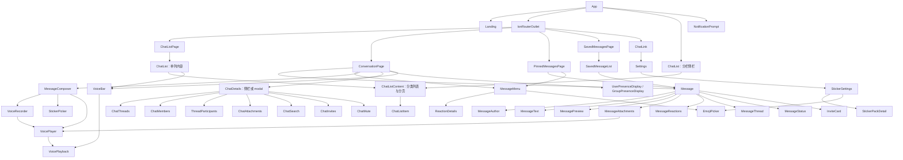

# 组件

组件负责本地交互和显示；跨页面数据通过共享 Store 读取。表格只描述输入输出、字段归属和依赖，产品行为见[需求](requirements.md)，请求协议见[数据流](data-flow.md)，尺寸见[外观](appearance.md)。

## 组件关系

收藏、搜索、附件定位、话题列表、好友资料、创建/加入和通知通过 ConversationNavigation.open 关闭弹层并进入会话；消息定位由目标页面执行，同一路由的重复定位通过 requests$ 交给已有页面，不保存额外导航状态。

MediaViewer、ChatDetails 的独立模式、StartChat、StickerPicker 的详情模式和设置各页由 ChatLink 按路由创建和关闭 modal。简单展示组件不为数据传递新建服务。

## 根布局与聊天列表

| 组件               | 输入、输出与局部字段                                                                                                 | 数据依赖                                                                              |
| ------------------ | -------------------------------------------------------------------------------------------------------------------- | ------------------------------------------------------------------------------------- |
| App                | landingPage、启动 loading/error、splitPaneVisible、sidebarSelection、浏览器返回动画状态、全局更新 toast 和可交互标记 | SessionStore；路由决定单列页面，分栏分类选择保存在根组件                              |
| NotificationPrompt | 首次通知询问；弹窗开关、允许按钮等待状态、toast 引用                                                                 | PushNotifications                                                                     |
| ChatListPage       | 路由分类/归档范围；active；接收 openList 并导航                                                                      | 将 selection 和 active 传给单列 ChatList                                              |
| ChatList           | selection、active → openList；搜索词、原生 segment 与内容 ID                                                         | SessionStore、ChatListStore、Preferences、AppInstall；控制分类面板与菜单，active 时同步 selection，头像菜单提供收藏、设置与安装入口 |
| ChatListContent    | selection、active → openList；刷新状态、查询消费者、显示准备状态、派生列表行、一个可见行 observer 和在线范围释放函数 | ChatListStore、ChatStore、DraftStore、MessageOutbox、Preferences、SessionStore、Presence |
| ChatListItem       | entry（含未读数、unreadMentions 与 unreadReactions）、online、button、两侧 actions、actionsAlwaysVisible → selected；pendingAction、操作失败与滑动引用 | 接收行数据和回调，不自行读取聊天或在线数据；mention 显示 @ 徽标，reaction 只显示心形徽标，均不显示数量 |
| ChatAvatar         | entry、size、online | 由输入派生头像、占位、话题角标和在线圆点，无请求 |
| DirectorySearch    | query、usersOnly、selecting → selected；群/用户结果、群游标和请求版本                                                | GroupsService、UsersService；选择用户或打开资料                                       |
| ChatLink           | 路由参数；failed                                                                                                     | 解析链接和静态路由配置、按需查询消息/用户；负责详情弹窗与浏览器历史的生命周期         |

ChatListPage 在 ionViewWillEnter 中先同步检测缓存视图，再激活列表查询，使 pop 动画使用已更新的本地行；ionViewDidLeave 同步释放子查询消费者。

ChatListContent 的普通会话行和话题行都是共享资料、查询成员、草稿和待发消息的派生结果；本人发送的最后一条非系统、未撤回消息在预览正文后显示待发队列派生的发送中或已发送，私聊另外使用 ChatStore 的对方回执显示已读；待发消息按聊天或话题根区分，在服务器摘要回显前提供预览和排序时间，话题回复不改变父会话行，已确认后由共享摘要替换。分类内容各自保留滚动位置，仅当前分类激活查询和续页。tab、归档范围属于父组件；操作进度属于被点击的行。固定入口与独立角标不参与初次内容等待。隐私首页摘要失败在对应行显示重试文案，其余加载失败使用 LoadError（message、compact、retryable → retry）：页面级居中，列表和设置分区使用紧凑行。

## 消息页面

| 组件               | 输入与局部字段                                                                                               | 数据依赖与传递                                                                                                                                        |
| ------------------ | ------------------------------------------------------------------------------------------------------------ | ----------------------------------------------------------------------------------------------------------------------------------------------------- |
| ConversationPage   | id、threadId、message、reply；进入上下文、定位目标、未读边界、滚动锚点、输入/回复/编辑、置顶选择、信息栏开关、当前 DM 范围的授权回执 | 提供 ConversationStore；消费 ChatStore、MessageOutbox、DraftStore、ConversationNavigation；向 Message、MessageMenu、MessageComposer、ChatDetails 和 Presence 展示组件传值 |
| PinnedMessagesPage | id、threadId；活跃版本、loading/failed、滚动状态与浮动日期                                                   | 从共享 ChatPins 派生消息，复用 Message 和 MessageMenu；无需 ConversationStore                                                                         |
| SavedMessagesPage  | active                                                                                                       | 路由及 toolbar；离开时销毁 SavedMessageList，重新进入时重新创建                                                                                       |
| SavedMessageList   | saved、nextCursor、loading/failed、取消收藏状态                                                              | 全局收藏接口；快照映射给非交互 Message                                                                                                                |

ConversationPage.rows 合并已确认区间与队尾，按 clientGeneratedId 保持行身份，在原位置覆盖待保存的编辑，过滤撤回意图不可见的消息（撤回的普通消息整行移除，话题根保留为墓碑行）。日期与连续作者分组从最终可见行派生。
会话标题在普通私聊显示 `UserPresenceDisplay`，普通群聊显示 `GroupPresenceDisplay`；话题不显示群人数。展示组件注册可见范围到应用级 Presence，ChatDetails 的私聊资料和群资料复用相同展示组件，不自行保存在线或人数副本。
UserPresenceDisplay 按 online、away、模糊区间、精确时间的顺序展示；away 使用普通状态文字，不向头像传递在线断言。UserPresenceDisplay 和 GroupPresenceDisplay 始终保留状态行，仅在对应有效范围等待快照时展示紧凑线框；pending 范围属于 Presence，而不是组件自行启动的定时器。列表行的在线布尔值直接派生自同一 Presence，不向 ChatStore 或聊天列表响应复制在线字段。

输入文字、回复对象与编辑目标由页面持有；Composer 通过 model 和输出传递变化。引用来源栈、当前置顶选择等只保留需要重新查找的 ID；已有同一对象引用无需转成 ID。未读数字直接消费 ChatStore。滚动中的已读与分页判断共用一次滚动尺寸读取；已确认消息的元素集合随消息行和视图变化派生，不在每次滚动时重新过滤。置顶栏持有当前显示的置顶对象引用，仅在栏位出现或消失时等待触摸与惯性结束；共享的置顶数据仍即时更新。

ConversationPage 持有当前群聊或群聊话题的 mention 跳转 ID、请求及过期状态；加载与合并规则见[数据流](data-flow.md)。所有会话的 reaction 跳转 ID 在进入前台、恢复可见和重连时读取。私聊及其话题不显示 mention 跳转入口。新目标与尚未跳转的目标去重合并；跳转成功或目标已删除时移除该目标。reaction 按查询响应的 readThrough 确认，前台离开时再确认；mention 依赖消息已读游标、不单独确认。FAB 按消息时间从旧到新逐个定位，同时可见时纵向堆叠。消息已读游标推进时，游标及之前的 mention 和 reaction 跳转目标同时从 FAB 移除；reaction 服务端游标仍按查询快照确认，普通消息已读不推进该游标。阅读期间推进的边界同时过滤在途 reaction 查询的迟到目标；之后新发起的查询仍可包含旧消息上的新表态。

scrollActivity.moving 控制浮动日期，idle 同时要求没有触摸与惯性，用于分页合并和置顶栏显隐；visibleDate 来自已有视口测量。Ionic 缓存页面通常在离开时释放区间和组件资源；群聊被其话题覆盖时保留消息节点和位置，返回时补取消息，离开这组群聊/话题后释放。DraftStore 与 MessageOutbox 的生命周期独立于页面。

## 消息展示与操作

| 组件               | 输入、输出与局部状态                                                                                                                         |
| ------------------ | -------------------------------------------------------------------------------------------------------------------------------------------- |
| Message            | message、own、分组标志、preview/interactive、待发状态/附件、菜单操作等待、跳转状态 → reply、jump、openThread、menu、react、retry；只持有手势和点击抑制状态 |
| MessageAuthor      | sender、own；派生用户名、用户组和性别                                                                                                        |
| MessageText        | text、mentions、interactive、profilesEnabled；派生文本片段，点击提及才打开资料                                                                                |
| MessagePreview     | 消息摘要字段、interactive（默认 false）；派生去重附件类型与正文、系统短语枚举；交互模式下系统用户名链接资料                                  |
| MessageAttachments | message、overlayTime、outgoing、delivery、read、uploads；派生媒体框、相册布局、时间、发送/已读及上传反馈；局部保留相册初始尺寸、容器宽度、窗口及消息区域尺寸与资源加载失败 |
| MessageStatus      | delivery、read；显示上传、发送中与已确认图标（失败重试由 Message 在气泡左侧显示），并仅按 ConversationPage 传入的当前 DM 范围授权回执将确认单勾替换为双勾 |
| MessageReactions   | reactions、own、preview → react；头像与数量由输入派生                                                                                        |
| MessageThread      | info、preview → open                                                                                                                         |
| InviteCard         | code；preview、loading、failed；卡片自己维护固定几何与预览请求                                                                               |
| MessageMenu        | messages、chatId、threadId、canReply → reply、edit、editQueued、openThread；公开 open、reset、reactTo、busy、busyMessageId                       |
| ReactionDetails    | chatId、messageId；完整表态名单、选中表情、loading/error                                                                                     |
| EmojiPicker        | chosen 输出 Unicode 字符串；封装 @nicematic/emoji-picker 的尺寸与中英文语言映射，局部提供 PickerData、PickerSearch、PickerFlags，使用组件自带最近记录服务 |

`picker-emojis.generated.json` 由 `npm run emoji:picker:generate` 从固定版本 `emojibase-data` 生成并提交，包含英文名称、英/简中/繁中搜索关键词、分类和准确的肤色序列。PickerData 与 PickerSearch 通过组件局部 provider 替换库内各自独立的数据源，网格、搜索、肤色浮层使用同一份数据；普通肤色查表转换，混合肤色作为独立条目保持原序列。搜索忽略大小写，空白分隔词取交集，完整表情精确匹配优先并容忍省略 VS16，输出使用与输入校验一致的 Unicode 17 RGI 序列，避免额外 VS16 将相同表态拆成不同键。生成器校验覆盖全部 RGI 序列。数据及索引只随 EmojiPicker 的延迟代码加载，静态索引在模块内复用，每个选择器的查询状态独立。

PickerFlags 禁用第三方组件的全量国旗预加载，保留图片 URL 缓存和浏览器原生图片懒加载；初始化不依赖 `requestIdleCallback`。肤色浮层在渲染后使用原生 `popover="manual"` 进入浏览器顶层，沿用库内视口坐标和选择、关闭事件，避免外层 modal/popover 的 transform 和 overflow 改变定位或裁切；元素销毁时浏览器自动移除顶层浮层。

MessageMenu 的 selection 保存消息标识、原消息元素和点按坐标，从页面数组或 MessageOutbox 解析当前内容。可用操作、排序和翻页页码由消息状态、聊天类型与好友关系派生，页码在 open 和 reset 时归零。确认意图、操作提示、选择表情和弹窗状态属于菜单，busyMessageId 标识正在执行操作的消息；菜单测量完整预览与面板的尺寸，预览保留原横向位置与宽度，面板各自避让左右边缘；高度能容纳时整体竖向定位，超长时把预览正文对齐原元素、面板定位到点按附近；不修改底层列表和滚动位置。

MessageActions 由菜单和会话页各自提供，复用逐条撤回及表态请求；收藏由 SavedMessageStore 执行；ChatPins 执行置顶。菜单关闭后的 busyMessageId 由页面传给对应消息，在消息右上角显示等待。复制在点击处理内发起，以保留 Safari 用户激活；缺少异步剪贴板（非安全上下文、部分 WebView）时由 `api/clipboard.ts` 降级到临时文本框和 `document.execCommand`，两者都失败才作为操作失败。菜单 reset 使旧操作的界面反馈失效，最近表情保存到 Preferences。

## 转发组件

| 组件 | 状态与职责 |
| --- | --- |
| ForwardPicker | messages 输入为固定的 MessageResponse／OutgoingMessage 选择引用，可选 load 在选择目标时读取当前来源（话题整体转发）；closed 输出；持有搜索、弹窗开关、解析与失效状态；消费共享聊天／话题查询，选择目标后通过 ConversationNavigation 将来源交给 DraftStore 并导航 |
| ForwardedLabel | name 输入；复用转发来源图标与文案，用于气泡、引用和输入栏 |
| ForwardedCard | preview 输入；只展示标题、前三条摘要与总数，不请求详情 |
| ForwardedRecords | 路由 id／messageId 或 savedId，以及可选 bundleId；独立只读会话页面，复用 conversation-header、messageRows、Message 和 scrollActivity，视口测量同时派生浮动头像与日期；内部引用定位，子记录路由导航；持有详情失效与后台校验状态，订阅根消息删除和共享聊天权限事件 |

ConversationPage 的选择项保存已确认消息或 OutgoingMessage 引用，分别用服务端 ID 或 clientGeneratedId 标识；仅已获得服务端 ID 的队列消息可选；发布后沿用选择，选择目标时读取其最新确认数据并脱离队列对象。多选期间停用浮动头像，显示消息行原位头像，点击统一用于选择。页面持有多选撤回确认快照、处理状态与结果提示；权限沿用单条撤回规则，失败项保留选中。

ConversationPage 消费 DraftStore 中当前聊天／话题的待转发来源，草稿只保存服务器消息数据；转发预览通过 MessageComposer 的投影区域显示；forwardPreview 提供单条内容，forwardParticipants 从按消息 ID 排序的所选消息中按作者 UID 去重。MessageComposer 的 forwarding 输入控制空文本发送、媒体入口与发送按钮，forwardSubmitted 输出提及展示快照；普通附件与编辑上传不移交给转发任务。

Message 的 selecting／selected／selectable 与 toggleSelected 输出用于会话多选；多选时内部消息行设为 inert，使禁用按钮、媒体控件及其他内容均不参与点击命中，由外层宿主统一捕获点击并按 selectable 切换选择。record 输入禁用内嵌消息菜单、普通回复及语音源位置跳转，bundleOpened 由详情处理。savedId 指定收藏卡片的读取入口。MessageMenu 持有直接转发的选择器，仅 allowSelect 为真时显示多选并向页面输出 select；置顶列表支持直接转发。

ConversationPage 持有 selecting、selectedMessages 与 forwardSources；输入组件在多选时隐藏而不销毁。MessageOutbox 的转发任务保存固定请求与用户确认的 allowPlaceholders，展示内容沿用 MessageContent；由后端报告的占位需求在队列中请求确认，同意后复用原操作 ID；详情快照不写入活消息缓存。

ForwardPlaceholder 枚举定义后端原因代码，placeholderLabel 返回翻译键；MessagePreview 和应用通知共同使用，Message 正文复用预览展示占位内容。

## 输入和媒体

| 组件            | 输入、输出与局部字段                                                                                           | 所有权                                                                                                  |
| --------------- | -------------------------------------------------------------------------------------------------------------- | ------------------------------------------------------------------------------------------------------- |
| MessageComposer | chatId、text model、editing、editingUploads、relationship、mentionsEnabled；submitted 输出包含文字/附件/语音/贴纸的 Composition | 持有未提交上传、面板选择、提及候选及局部拖入层数；手动键盘操作输出 editLast / escape 给页面             |
| VoiceRecorder   | active model → submitted(File)、discarded；录音状态、计时、Blob、手势目标与错误                                | 设备资源和未发送录音属于组件，离开时释放                                                                |
| UploadProgress  | value（0–1）                                                                                                   | 输入栏和消息附件共用的固定尺寸 SVG 进度环，只负责呈现                                                   |
| VoicePlayer     | src、dock；playing、loading、failed、elapsed、duration、波形状态                                               | 挂载时创建 Audio 和 WaveSurfer 并读取波形；同一时间播放一条；带 dock 的消息语音把播放状态交给吸顶播放条，销毁时由 VoicePlayback 接管音频继续播放 |
| VoiceBar        | 无输入，读取 VoicePlayback；toggle/dismiss/speed 经活跃语音执行，locate 经 ConversationNavigation 打开消息所属会话 | 只负责呈现吸顶播放条，挂在主栏 header 底部：会话页、聊天列表移动端页与桌面空态页各挂一个，桌面侧栏列表实例不挂 |
| StickerPicker   | embedded、selectable、packId、stickerId → selected；content、packs、busy/error、长按菜单                       | content 保存当前包或贴纸列表，pack 和 stickers 从中派生；详情选中项按 ID 从当前列表派生，不复制包内贴纸；包列表按用户贴纸包顺序排序，发送贴纸时按开关记录包使用顺序 |
| MediaViewer     | media、initial；index、scale、加载状态与拖动坐标                                                               | 当前消息的媒体集合与本地画布，不写入聊天状态                                                            |

附件菜单使用原生 popover 顶层浮层，打开时按附件按钮当前位置定位，不改变输入焦点；点选媒体或文件时先关闭菜单、同步释放当前焦点，Android 上若选择前仍有输入焦点，等待至少 400ms 且 resize/scroll 静默 150ms 后触发文件输入，最长等待 1s，保持在浏览器临时用户激活时限内；其他情况直接触发文件输入。重新输入、重开菜单或重置输入区会取消尚未触发的选择器，重置也关闭菜单。菜单项继续使用 Ionic 列表组件。

上传任务提交后归 MessageOutbox，编辑只借用任务引用。输入区可以继续输入和录音。VoicePlayer 不显示原生音频控制条，挂载即下载音频并解码波形，波形读取失败时仍保留可用播放。消息语音的播放由根服务 VoicePlayback 独占：播放中的语音在离开或切换会话后继续播放，VoiceBar 吸顶播放条随语音出现在会话页和聊天列表页的 header 底部，接管播放/暂停、跳转原消息、已播时长与倍速，关闭或播完即收起；倍速由 VoicePlayback 全局记忆，跨语音保持；录音预览与待发送预览不进吸顶条。

创建贴纸包直接使用创建响应中的完整详情，并追加到包列表；贴纸库上传新贴纸后重读该包，包详情页上传后把响应追加到当前列表。收藏状态写回当前 content，随后订阅更新不会恢复过期的收藏值。

## 资料、搜索与管理

| 组件               | 输入与局部字段                                                                                                                                          | 共享数据/输出                                                   |
| ------------------ | ------------------------------------------------------------------------------------------------------------------------------------------------------- | --------------------------------------------------------------- |
| ChatDetails        | chatId 或 user、modal、view、currentConversation、threadId、threadRoot、messages → closed；tab、字段编辑草稿、头像上传进度、pending/error、详情 loading、当前好友的 presenceOverride/readReceiptOverride 及其 loading/error 与请求版本 | ChatStore 的头像、标题、详情、订阅与好友关系；FriendsService 读取/保存本人在线状态和已读回执覆盖值，Presence 失效个人状态 |
| ChatThreads        | chatId；items、cursor、loading/error、打开状态                                                                                                          | 从聊天消息页提取话题根，点击导航                                |
| ChatMembers        | chatId；members、cursor、loading/error                                                                                                                  | MembersService；行点击打开资料，仅管理员显示右侧身份            |
| ThreadParticipants | rootId、root、messages；派生参与者与名单范围                                                                                                            | 话题参与者缓存及已加载消息按 UID 合并，无独立请求，点击打开资料 |
| ChatAttachments    | chatId、kind；items、cursor、loading/error、打开/定位状态                                                                                               | 列表归组件，打开原消息媒体或定位上下文                          |
| ChatSearch         | chatId；query、sort、messages、cursor、loading/error                                                                                                    | 聊天消息搜索，点击定位原消息                                    |
| ChatInvites        | chatId；邀请列表、创建限制、目标用户与操作状态                                                                                                          | InvitesService；DirectorySearch 选择指定用户                    |
| StartChat          | kind、code；创建/加入表单、搜索词、邀请预览、busy/error                                                                                                 | 点击提交才创建或加入；改邀请码会使旧预览不可提交                |
| ChatMute           | 公开 toggle(chatId)；菜单选择                                                                                                                           | 调用 ChatStore.setMuted，原调用按钮持有等待状态                 |

ChatDetails 的侧栏、会话信息 modal 和用户资料 modal 共用一个组件，均无 toolbar。基础资料有缓存就直接显示；当前标签独立读取，不等待详情或好友关系。切换聊天恢复默认标签，切换标签销毁原列表组件并释放读取；标签顺序见[需求](requirements.md#信息群组好友与搜索)。名称和简介仅在进入编辑时创建各自的 Signal Form 字段草稿，保存只提交对应字段，另一个字段的草稿保持不变；切换会话清空草稿及头像上传进度。资料写操作共用组件内 perform：等待与错误随聊天/话题范围重置，迟到响应仍更新原聊天的共享数据，但不关闭当前表单或触发旧页面导航。

ChatDetails 和 ConversationPage 激活同一个好友关系查询。用户资料中的添加/删除/拉黑成功后刷新它；所有消费者随共享值变化，不各自请求并维护副本。

## 设置与应用外围

| 组件                       | 状态与职责                                                                     |
| -------------------------- | ------------------------------------------------------------------------------ |
| Settings                   | 当前用户和更新状态；持有局部更新结果，打开通知、隐私、聊天、贴纸与语言子页 |
| NotificationSettings       | 通知开关、权限申请按钮、订阅等待和失败重试；进入时 refresh，权限拒绝使用 toast |
| GeneralSettings            | 聊天设置直接编辑 Preferences 的颜色模式、消息字号及三个显示开关，无额外状态副本                       |
| LanguageSettings           | 自动/三种语言的单选；写入 Preferences 并调用 Localization 切换 catalog         |
| FriendVerificationSettings | Signal Form、读取/保存状态与结果；FriendsService                               |
| PrivacySettings            | 四项隐私入口；独立读取拉黑列表、好友验证、在线状态和已读回执设置资源，显示实际摘要与加载状态，窄屏摘要位于标题下方 |
| ReadReceiptSettings        | 全局回执开关、读取/自动保存状态；FriendsService 读取/保存，成功后通过 ChatStore 失效回执隐私 |
| BlockedUsers               | 拉黑用户列表、空状态和加载失败重试；点击用户路由打开资料页 |
| PresenceSettings           | 全局 visibility、loading/saving、读取/保存失败与成功反馈；FriendsService 读取/保存，成功后通过 Presence 失效个人状态 |
| StickerSettings            | 置顶表态编辑（输入过滤与表情选择器）、自动整理开关、创建贴纸包、贴纸包重排列表 | StickersService、StickerPreferences、Preferences；重排写入中点使用时间并同步服务器 |
| StickerPackDetail          | packId；包详情、owned 状态、重命名/删除/退订与添加、点按移除贴纸               | StickersService、StickerPreferences；删除与退订移除顺序条目并关闭弹窗 |
| AppInstall                 | 启动时捕获浏览器安装事件，available 控制菜单入口；点击消费事件并调用安装提示，安装完成时清除事件 |
| Landing                    | 检测平台与选中平台；公开安装指引                                               |

置顶表态输入由 `settings/emoji-sequences.ts` 提取完整的 Unicode 17.0.0 RGI emoji 序列；匹配集合固定，不依赖浏览器自带的 Unicode 数据或正则 `u` / `v` 标志。该文件由 `npm run emoji:generate` 生成并提交，生成器及 Unicode 数据依赖使用精确版本；升级匹配集合时更新依赖并重新生成。交互约定见[表情与贴纸设置](requirements.md#通知静音与设置)。

设置与详情统一由 ChatLink 路由托管 modal，关闭恢复浏览器历史；会话缓存保留底层状态。Localization 在首个页面渲染前读取保存的语言并加载 catalog；语言页切换时先加载目标 catalog，再更新活动语言。Landing 只提供安装指引，普通浏览器中 App 在该入口只同步恢复并保存 token；已安装 PWA 由路由 guard 重定向到聊天并正常初始化登录。

消息、提及、成员和目录结果通过 Router 打开资料，不直接依赖 ChatDetails；弹窗组件的静态导入集中在路由入口，展示组件之间没有循环依赖。

会话标题栏提供搜索与静音入口：搜索弹窗复用 ChatSearch，静音复用 ChatMute，读取 ChatStore 的共享静音状态。

ChatList 的四个 tab 数字消费集合 `unreadUnmutedConversationCount`，有未静音 mention 时由 `@` 替代数字，两者均为零时隐藏。ChatList 与 PushNotifications 的后台标题共用 ChatListStore.tabBadges，其 `@` 仅消费集合 `unreadUnmutedAttentionCount`，原始 attention 不驱动这两处提醒；会话内标题改用该会话的共享读状态。ChatListContent 使用话题响应的 `chatKind` 决定 mention、作者与头像徽标；父聊天详情仅补充名称和头像，不影响类型判断。ChatListItem 保留静音群聊和归档话题的行内 mention badge，使用 medium 色，选中时仍保持灰色。

`conversationUnread` 管理 ChatListStore 的连接级未读订阅、消费者、快照和 requestId；Connection 负责 WS 编解码与发送。系统图标和列表共享订阅，不创建单独的未读 HTTP 查询。
