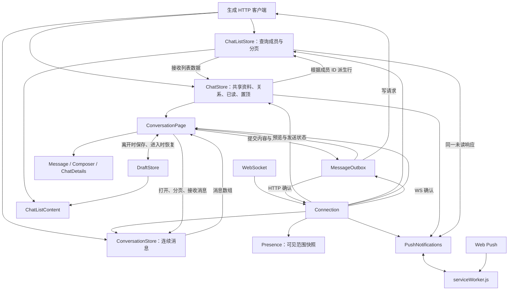

# 数据流

HTTP 使用生成客户端，实时事件来自唯一 Connection。共享资料与列表查询属于应用；连续消息区间属于页面；滚动、表单、搜索结果与操作反馈属于组件。

## 所有权与存储

| 所有者                 | 保存的状态                                                              | 生命周期                                                    |
| ---------------------- | ---------------------------------------------------------------------------------- | ----------------------------------------------------------- |
| SessionStore           | token、当前用户及用户组                                                 | 应用；token 保存到 localStorage 和 Cookie                   |
| Connection             | 唯一 WebSocket、认证/心跳/重连、最近 256 个新消息 ID                    | 应用                                                        |
| Presence               | 可见用户/普通群范围、最后授权快照、待回包的用户/群范围、一个分钟时钟与当前请求号 | 应用内存；展示消费者释放或文档隐藏即停止范围和时钟，不持久化 |
| ChatStore              | 聊天资料、摘要、归档/静音、已读、话题摘要与订阅、好友关系查询、ChatPins | 应用缓存，不保存全部历史消息                                |
| ChatListStore          | 查询成员 ID、游标、覆盖范围、消费者、好友请求与共享未读响应             | 应用；无消费者时取消读取                                    |
| ConversationStore      | 连续消息区间、双向游标、请求状态、期间收到的补丁、用于改写引用快照的撤回与编辑记录 | 每个 ConversationPage；由页面生命周期控制                   |
| MessageOutbox          | 已提交内容、编辑/撤回意图、上传、确认与重试                             | 应用内存；跨页面，整页刷新不恢复                            |
| DraftStore             | 文字、回复目标 ID、保存时间                                             | 按账号和聊天/话题保存到 localStorage                        |
| Preferences            | 话题/头像/私聊作者信息显示偏好、消息字号、最近表情、置顶表态表情                                        | localStorage                                                |
| StickerPreferences     | 自动整理开关、收藏贴纸使用顺序；读写 SessionStore 中的贴纸包顺序        | 应用；开关与收藏顺序保存到 localStorage，包顺序以服务器为准 |
| MessageActions         | 请求操作，不保存消息缓存                                                | 每个 MessageMenu                                            |
| ConversationNavigation | 关闭会话入口弹层、路由与即时定位；不保存消息或位置                      | 应用；当前页面消费                                          |
| PushNotifications      | 本机通知意图、浏览器权限、操作状态、去重记录                            | 应用；本机意图保存到 localStorage，去重保存到独立 IndexedDB |
| AppUpdates             | 检查更新和可更新状态                                                    | 应用                                                        |

话题订阅的已知值、新鲜度与响应版本保存在同一缓存条目中；失效时继续显示已知值，读取使用新鲜度判断，不另存一套失效 ID。

ChatPins 是 ChatStore 内部的普通对象，不是额外服务。ChatDetails 和 ConversationPage 共享按 UID 的好友关系查询。收藏由 SavedMessageList 持有快照，不进入活消息缓存。组件字段见[组件](components.md)。

同一对象被多处引用不构成数据副本，不为节省指针改成 ID。ID 用于查询成员、导航目标和需要回到共享状态查找最新内容的地方；不能从服务派生的表单、滚动与搜索状态由组件持有。

## 启动存储迁移

LegacyMigration 通过 Angular 初始化器先于组件和偏好服务运行，只读取旧数据库 `wetty`。不存在旧库时中止创建；有旧库时将 Token 补入 `jwt_token`，把 `draft:聊天ID_thread_话题ID` 转为按原 Token uid 归属的 `chahua.drafts.uid` 与 `聊天ID/话题ID` 键，回复字段转为 `replyTo`，保留保存时间和更晚的新草稿。话题显示、全部头像、最近表情转换为 Preferences 的 localStorage 格式；已有新偏好不覆盖。

没有对应界面的旧设置以及无法确认归属的草稿保存在 `chahua.migration.wetty.backup`；旧贴纸排序同样留在备份中，现用贴纸包顺序以服务器 `stickerPackOrder` 为准。所有写入成功后标记已转换，再后台删除旧库；失败保留旧库供下次重试。旧标签页阻挡删除时不阻塞应用启动，后续启动跳过读取、继续删除；连接释放后完成删除并标记迁移完成。通知独立数据库不受影响。

## 身份、协议与入口

SessionStore 按 URL token、localStorage、Cookie、开发预设选择身份并移除 URL 中的 token；开发构建在没有这些 token 时请求 `POST /auth/dev-session`，以 sessionStorage 的 `uid`（默认 1）和 localStorage 中持久化的 `X-Client-Id` 换取身份。localStorage 和 Cookie 使用同一个键 `jwt_token`；读取身份及刷新 token 时同步写入两处。Cookie 只属于当前主机，使用 `Path=/`、`SameSite=Lax`，HTTPS 下设置 `Secure`，每次写入续期 400 天。Cookie 过期不影响 localStorage；只有 Cookie 时自动补入 localStorage。退出登录或登录收到 401 时清除两处，网络失败保留凭据供重试。请求仍使用 Bearer token。

iOS/iPadOS 17.2+ 与 macOS Safari 安装网页应用时复制 Cookie，不复制 localStorage；安装后两边存储独立，已安装应用不会收到 Safari 后续的登录变化。更早 iOS 不提供这条安装登录传递；`start_url` 固定为 `/chats`，不携带 token。[WebKit 安装行为](https://webkit.org/blog/14787/webkit-features-in-safari-17-2/#login-cookies)

选定身份后依次 `POST /auth/refresh`、`GET /users/me`、`GET /users/search?q=UID&limit=1`；最后一步补用户组，失败不阻塞登录。后续 HTTP 和 WS 中的本人资料更新共享身份；全局与单聊天收藏快照均不参与更新。待发消息从当前身份派生作者资料，更新资料不重连 WebSocket。

默认 API 基地址为 `/_api`；跨域生产构建通过 `CHAHUA_API_BASE` 使用 `https://chahui.app/_api`，HTTP 与 WebSocket 共用该地址，Bearer token 仍来自页面源的身份存储。构建与资源部署约定见 [README](../README.md#开发)。SnowflakeID 是有意使用的可排序无损 number 编码，HTTP/WS/路由边界编解码，普通 UID 和计数不转换。null/undefined 原样保留；仅 UpdateChatBody.avatarImageId 与 PatchInviteBody.expiresAt 显式允许请求 null 表达清除。JSON 拦截器保留 FormData，二进制上传不按 JSON 转换。

App 先调用 SessionStore.restoreToken 同步读取并保存 token，后续 initialize 及登录重试复用内存中的 token；没有 token 时，生产构建直接显示无应用外壳的 418，不启动登录请求；开发构建在业务路径先获取开发会话，普通浏览器的 `/landing` 仍直接显示 418。有 token 时，普通浏览器的 `/landing` 只恢复 token，不刷新凭据、不获取用户、不启动通知或打开邀请预览。已安装 PWA 的 `/landing` 由同步路由 guard 重定向到 `/chats` 并替换历史记录，App 正常初始化登录。其他业务页面由 App 的身份加载/错误状态控制，进入时才执行登录请求。

index.html 的独立内联脚本在 Angular 加载前检查更新；先复用已有 Service Worker，没有注册时确认生产 ngsw.json 后注册 serviceWorker.js。脚本直接使用 Angular Worker 的 CHECK_FOR_UPDATES / OPERATION_COMPLETED / VERSION_READY 消息，等待完整版本下载；Worker 脚本另用 registration.update() 检查。前台每 60 秒检查，恢复联网、回到前台和 controller 变化时也尝试检查；同一脚本不并发检查，失败或超时保留当前页面并重试。会话内记录自动刷新过的版本 hash，避免同一版本反复刷新。App 在已登录的业务页面完成渲染后标记为可交互；此之前及 landing 可以自动应用已就绪版本，可交互页面交给更新提示确认。

Service Worker 缓存应用资源（包括 landing 安装页及含表情数据的延迟加载代码），不缓存业务 API。表情选择器的最近记录由 @nicematic/emoji-picker 存入 localStorage，与 Preferences 的快捷表态记录独立。共享聊天数据仅在内存，连续消息的保留与释放由页面生命周期决定，没有离线消息数据库。

表情选择器不预取全部国旗图片。国旗图片使用浏览器原生懒加载，在滚动或搜索使对应图片接近可见区域时请求；加载失败沿用组件的 Unicode 字符回退。

## 何时请求

下表省略 `/_api`，c/t/m 分别表示聊天、话题根和消息 ID。

| 触发                          | 接口与参数                                                             | 消费路径                                    |
| ------------------------------------------ | ---------------------------------------------------------------------------------------------------------------- | ----------------------------------------------------------- |
| 激活聊天分类或续页            | `GET /chats?limit=50`，归档加 archived，续页加 after                   | ChatListStore → ChatStore → ChatListContent |
| 话题 tab，或消息 tab 开启话题 | `GET /threads?limit=20`，archived 与 before 时间游标                   | ChatListStore → ChatStore → ChatListContent |
| 消息/好友列表显示请求         | `GET /friends/requests?archived=false`                                 | ChatListStore → ChatListContent             |
| 打开请求历史                  | 同接口 archived=true；无前端续页                                       | 独立历史查询                                |
| 显示 tab、归档计数或系统角标 | WS `watchConversationUnread`，包含对应 tab 的普通/archived 集合与 appBadge | 消费者共享订阅，服务端推送变化 |
| 被覆盖的列表收到消息                       | 保留共享预览并标记读状态过期；返回后用逐会话 WS 快照校准，尚无快照时合并 HTTP 读取，窗口外的新聊天从首页补读至原覆盖边界 | ChatListStore → ChatStore                                   |
| 列表失效（断线重连、手动刷新） | `GET /chats?limit=50`，读取到已加载条数或末尾                                                                    | ChatListStore → ChatStore → ChatListContent                 |
| 缺聊天资料；打开详情或菜单    | `GET /group/{c}`，按缓存新鲜度去重                                     | ChatStore → 标题、资料、权限                |
| 私聊或用户资料缺关系          | `GET /friends/{uid}`                                                   | ChatStore.relationship → 三处共用           |
| 用户资料的验证方式            | `GET /friends/add-info/{uid}`                                          | ChatDetails 在点击添加好友后读取            |
| 恢复普通对话，读状态无缓存    | `GET /chats/{c}/unread`                                                | 页面决定打开位置                            |
| 恢复话题，读状态无缓存        | `GET /chats/{c}/threads/{t}/read-state`                                | 页面决定打开位置                            |
| 话题缺订阅状态                | `GET /chats/{c}/threads/{t}/subscribe`                                 | ChatStore → 订阅/归档按钮                   |
| 打开、定位、双向分页          | `GET /chats/{c}/messages?max=50`，around/before/after；话题加 threadId | ConversationStore → 页面                    |
| 回复预览或话题根缺失          | `GET /chats/{c}/messages/{m}`                                          | 页面局部预览                                |
| 活跃可见消息进入视口          | 普通/话题 read 的 POST，1 秒合并目标                                   | ChatStore 更新读状态和计数                  |
| 活跃私聊或私聊话题的对方已读 | `GET /chats/{c}/read-receipt`；话题回复加 threadId，话题根另读普通范围 | ConversationPage；范围切换、重连和 `readReceiptChanged` 时刷新 |
| 进入会话/话题（active）       | `GET /chats/{c}/reactions`（话题加 threadId）；随后 `POST /chats/{c}/reactions/read` | 先合并本次会话的跳转 ID，再用响应 readThrough 确认该快照，不清除快照之后的表态 |
| 离开会话/话题                 | `POST /chats/{c}/reactions/read`                                       | 清掉会话期间新到的 reaction                  |
| 进入会话/话题（mention）      | `GET /chats/{c}/mentions`（话题加 threadId）                            | 保留本次会话的跳转 ID；mention 计数由消息已读游标派生，不单独 ack |
| 置顶栏、置顶页、消息菜单      | 普通/话题范围的 `GET .../pins`                                         | 共享 ChatPins                               |
| 全局收藏                      | `GET /saved-messages`，limit=50、before                                | SavedMessageList 快照                       |
| 全局目录搜索                  | `GET /group`（joined）和 `/users/search`，300ms 防抖                   | DirectorySearch；群有游标，用户无游标       |
| 群资料中的成员标签            | `GET /group/{c}/members`，limit、after                                 | ChatMembers 局部分页                        |
| 资料中的话题标签              | `GET /chats/{c}/messages?max=50`，before                               | ChatThreads 筛选 threadInfo 根消息          |
| 资料中的媒体标签              | `GET /chats/{c}/attachments`，kind、limit、before                      | ChatAttachments 局部分页                    |
| 打开媒体或定位附件            | `GET /chats/{c}/messages/{m}`                                          | 当前消息的媒体集合，或所属话题路由          |
| 聊天内消息搜索                | `GET /chats/{c}/messages/search`，q、sort、limit、offset               | ChatSearch 局部分页                         |
| 邀请预览与管理                | `GET /invites/invite?inviteCode=...`、`GET /invites`                   | InviteCard、StartChat、ChatInvites          |
| 查看完整表态                  | `GET /chats/{c}/messages/{m}/reactions`                                | ReactionDetails；用 sortIndex 还原时间顺序并按用户聚合，按表情本地过滤 |
| 打开贴纸库                    | 收藏、已订阅包、自有包三个 GET                                         | StickerPicker；切包读取该包详情，包列表按用户贴纸包顺序排序 |
| 打开表情和贴纸设置            | `GET /stickers/packs/mine/owned`、`GET /stickers/packs/mine/subscribed` | StickerSettings 合并展示                                    |
| 打开贴纸包详情                | `GET /stickers/packs/{id}`                                             | StickerPackDetail                                           |
| 好友验证设置                  | `GET /friends/me/settings`                                             | 表单组件                                    |

Reaction 的已读是会话级：进入前台会话/话题、恢复可见或重连时读取 messageIds 与 readThrough；保留未跳转的目标，将新目标去重合并，再按 readThrough 确认快照。重复生命周期共享当前查询或已知结果；有效未读零跳过查询，真实重连或新通知强制校准。请求期间只有新通知或确认后仍有未读才追加查询；查询失败不确认。后台不查询或确认，前台离开时使用保存的聊天/话题身份再确认一次，不依赖旧路由仍激活。普通消息已读不推进 reaction 游标。

Mention/reply 的未读由消息已读游标派生（`message_id > last_read_message_id`），没有单独的 ack：进入会话时读取 messageIds 供会话内跳转，读到最新后计数自然清零；跳转同样按时间从旧到新。

Mention 跳转列表按当前页面会话保存，首次读取、真实重连及新提及/相关编辑时校准。有效的已知零可跳过首次请求，未知或过期计数不能当作零；冷进入先复用聊天资料请求，确认群聊后再查。普通前台恢复和重复进入共享已知结果或进行中的请求；新数据在 100ms 窗口合并，查询期间发生变化才追加校准。离开、隐藏及切换会话取消请求；覆盖后返回保留已有目标，撤回和成功跳转的 ID 不被迟到快照重新加入。

候选搜索不延迟正文或草稿更新：输入法组合期间不查询，查询按账号、chatId、关键词去重，等待 200ms 后发出并取消上一查询。组件内最多缓存 32 个结果，各自有效 30 秒；账号、聊天或 mention 开关变化取消请求并清空候选。

单会话读状态优先使用逐会话 WS 快照；尚未取得快照的范围只在过期时读取 HTTP，同范围实时变更在 100ms 内合并。列表无消费者或文档隐藏时只标记过期。已知消息的编辑比较当前用户的提及状态，未改变时不刷新；比较用的最多 256 条提及状态由已接受消息快照与实时事件维护，未知旧内容仍需校准。话题 read-state 同时返回 lastReadMessageId、unreadCount、unreadMentions、unreadReactions，GET 不推进游标。已加载话题更新自身计数及实时摘要，不重取其他分页；普通消息不引入未知话题；仅订阅者收到的 threadUpdate 补列表头部到原头部时间边界，订阅变化直接更新已知项，未知项或无法确认位置的通知按 ID 校准。普通话题消息不作废订阅缓存，threadMembershipChanged 的 status 快照直接更新 subscribed 与 archived；旧事件缺少 status 时才读取校准。

创建、编辑、归档、订阅、置顶、收藏、好友和群管理等写操作仅由用户动作触发。消息读标记由可见性触发。发送贴纸（自动整理开启且所属包在统计范围内）与拖拽重排后 `PUT /users/me/stickerpack-order`；同步失败时重新读取 `GET /users/me`，以服务器顺序恢复。请求期间的具体反馈见[加载标识](loading-indicators.md)。

## 分页、刷新与页面生命周期

健康连接恢复前台时，消息区间、话题列表、订阅、置顶和成功读取的私聊回执由已接收的事件保持，不重复读取；失败的查询仍可重试。当前会话隐藏期间继续接收消息，恢复后校验可见读位置。群资料、好友关系和申请历史缺少完整跨设备事件，仍校准；收藏等无可靠事件的数据保留原有读取。真正重连仍恢复订阅、补消息、校准列表与元数据。服务端普通事件队列溢出会断开该连接，强制走重连校准，避免把漏事件的连接当作健康连接。

普通对话列表查询按普通/归档范围共享成员和进行中的请求；记录成员 ID、游标、覆盖边界和待补未读，字段从 ChatStore 派生。刷新从首页逐页读取到已加载条数或末尾，每页到达即合并进列表；刷新完成后以响应中的成员替换旧窗口，期间保留现有内容。被其他页面覆盖不使列表失效，也不在返回时读取内容：实时消息已更新预览，隐藏列表记录受影响聊天，返回后恢复逐会话 WS 订阅；尚无快照的范围按需补读，未加载窗口外的新聊天从首页按需补页至原覆盖边界或末尾。普通聊天撤回最新消息时，若会话页已加载包含该消息的连续最新区间，直接用区间内前一条未撤回的普通消息恢复摘要和排序时间；完整空区间清空摘要。历史区间、未加载的被删消息或前一条消息落在更早分页时，仍由列表对账恢复。删除后的对账用于校准成员与未读，本地可确定的摘要不等待对账。连接实际断开后重连及手动刷新才校准完整已加载范围；归档、成员关系和删除按项更新。恢复前台本身不重读，避免切回窗口时等待请求。列表在进入动画开始前激活查询。初次显示或切分类等待当前分类的列表查询，固定入口和归档角标不参与等待。

已加载话题的回复消息通过 WS／HTTP 确认共用路径直接更新 ChatStore 的 lastReply 与 lastReplyAt；摘要版本阻止消息之前发起的列表响应覆盖新预览。待发回复直接从 MessageOutbox 派生预览与排序，不等待确认。话题列表的范围或按项校准负责成员、参与者、回复数，逐会话 WS 负责未读对账，已加载行的预览与排序不等待这些请求。撤回最新话题回复时，复用会话页已加载的连续最新区间恢复前一条回复及其时间，根消息不作为回复预览；完整区间已无有效回复时立即隐藏话题，并清除当前区间根消息的话题信息。摘要版本阻止旧列表响应复活已清空的话题；后续新回复可使缓存话题重新显示。无法从当前区间确定前一条回复时保留对账兜底。

只有消息 tab 开启话题时才使用两来源共同覆盖范围：未加载边界为 Infinity，末尾为 -Infinity，展示时间不早于两边较新边界的行。触底补覆盖较浅的一侧，相同则同时补。其他分类独立分页。群/好友的归档数字都是后端归档对话未读总数，不遍历归档历史分类型 count。

ThreadParticipants 优先读取 ChatStore 的话题参与者缓存，并合并 ConversationPage 经侧栏 ChatDetails 传入的已加载话题消息作者；独立话题详情通过消息接口读取根消息；缺少缓存时标明名单仅覆盖已加载范围，不额外读取历史。SavedMessagesPage 通过 SavedMessageList 读取全局收藏快照；进入媒体详情时保留列表与滚动位置；离开收藏及其详情时销毁列表，重新进入时重新读取。

ChatDetails 可由 chatId 或用户资料打开；后者从共享好友关系派生 dmChatId，得到可访问会话后读取详情和当前标签。不为资料另存好友状态。验证方式在点击添加好友后读取，发送前在确认弹窗内收集验证信息；添加、解除好友与拉黑操作完成后刷新共享关系。

资料列表的游标与请求属于各组件，切换标签后释放；有下一页且无错误时挂载 Ionic infinite-scroll，触底请求完成后调用 complete，不用 loading 禁用正在工作的控件；无下一页或错误时移除，重试恢复游标后重新挂载；成员、媒体和搜索首屏不足一屏时 fillScrollViewport 继续补页。ChatThreads 的游标来自原始消息响应，不从筛选结果推算；只由触底触发续页，空话题页不连续扫描历史，结果不限订阅状态。搜索与媒体汇总作用于所属聊天。

连续消息每页最多 50 条，使用普通 DOM。接近边缘 1.5 个视口时预取，一次一个方向；手指离开且惯性结束后才合并历史，以首条可见消息底部为锚。媒体预留尺寸。浮动日期复用同一滚动状态和可见消息测量。

Ionic 会缓存页面实例。群聊进入其话题时保留群聊区间、消息 DOM 和滚动位置，取消未完成的消息读取、清理菜单和未提交附件并暂停语音；进入设置或详情 modal 路由同样保留消息区间，并保留编辑与未发送附件；隐藏时不标记已读，返回复用原节点并按已有重连逻辑补取新消息。导航离开该群及其话题范围时释放保留的群聊。其他页面完成离开时清理连续区间、局部输入、菜单和读取；仅在真正离开后执行，允许取消 iOS 返回手势。列表释放查询消费者，共享资料/置顶仍可复用。局部读取和查询消费者随页面释放。已发出的资料写操作仍可更新原聊天的共享数据，界面收尾只作用于原范围；菜单等使用 takeUntilDestroyed 的请求随组件销毁结束订阅，MessageOutbox 则跨页面继续。异步结果使用请求版本或进入上下文，旧结果不能覆盖新页面。[Ionic 生命周期](https://ionicframework.com/docs/angular/lifecycle)

分栏下 App 持有 sidebarSelection，分类切换不改路由；单列分类共用 ChatListPage，通过无组件的子路由保留分类地址与浏览器历史。ChatList 保留四个 ChatListContent，仅起点与终点参与切换动画，各分类保留自己的滚动位置，只有当前分类激活查询和续页。ChatLink 根据静态路由数据创建设置或详情 modal，离开时关闭自己的实例；异步读取和呈现完成时校验页面版本，旧页面不能留下弹窗。关闭使用浏览器历史，直接打开且无应用内前页时回到聊天列表。ConversationNavigation.open 统一收藏、搜索、媒体定位、话题、好友资料、创建/加入与通知入口：关闭弹层并打开所属会话；目标 URL 已相同时通过 requests$ 定位，否则由路由输入触发一次定位。goTo 供当前会话接收列表点击等即时指令，不保存第二份导航状态。

## 实时事件与未推送的数据

| 事件                                                      | 更新路径                                                                                              |
| --------------------------------------------------------- | ------------------------------------------------------------------------------------------------------------------------------------- |
| message                                                   | Connection 合并 HTTP 与 WS 回声并去重；ChatStore 更新摘要、使已读失效；隐藏列表记录待补未读或首页位置；当前页面决定接收和是否跟随底部 |
| messageUpdated / messageDeleted / messagesBulkDeleted     | 更新摘要、置顶与已加载区间；编辑按服务器预览形状改写引用方内嵌的引用快照，撤回将其改为墓碑；正在读取的区间保留补丁；编辑刷新提及计数与全局汇总 |
| reactionUpdated                                           | 更新区间与置顶表态，保留广播缺省的个人选择                                                            |
| notification（mention/reply/reaction）                    | 服务端定向发送（包括撤销他人消息上的表态）；非话题标记该 chat 的读状态过期，已加载话题定向读取 read-state，未知话题按列表覆盖情况校准；当前会话合并读取对应跳转 ID（reaction 还会按会话级 ack 清除） |
| pinAdded / pinRemoved / threadPinAdded / threadPinRemoved | 更新已缓存的 ChatPins                                                                                 |
| threadUpdate                                              | 更新已加载根消息统计；新订阅话题补列表头部，未读由 WS 推送                                                                |
| threadMembershipChanged                                   | 用 status 快照更新订阅与归档；旧事件无 status 时补读，列表按项更新                                                                |
| friendRequestReceived / friendRequestResolved             | 请求列表失效；接受时刷新聊天，相关好友关系查询失效                                                    |
| friendshipRemoved                                         | 刷新相关关系查询和聊天归档计数                                                                        |
| chatArchiveStateChanged                                   | 更新归档/静音字段并迁移已知列表项，未知项按 ID 校准                                                               |
| readReceiptChanged                                      | 当前私聊页面与列表预览按 chatId 失效并读取对应范围；`privacyChanged` 先清除已知回执，普通推进保留已知回执直至新响应 |
| 首次 presenceUpdate、恢复前台                             | Connection 区分认证连接与前台恢复的 resync，同一次 focus/visibility 恢复只发布一次；健康连接保留事件维护的数据，断线重连校准已加载范围                                                |
| presenceSnapshot                                           | Presence 仅接收当前 `requestId` 的绝对授权快照；清除当前请求中缺席的用户/群，刷新期间保留已知状态；本机断网、断开或文档隐藏时不显示实时结论 |

Connection 每 10 秒心跳、退避重连；connected 在鉴权后的 presenceUpdate 为真。只有文档可见且窗口拥有焦点时才上报 active，否则为 inactive；心跳携带当前 state，连接打开并发送 auth 后，以及 visibilitychange、窗口 focus/blur 时立即发送 appState，不等待下次心跳。恢复可见且聚焦、连接已认证时发出 resync；未连接时等待认证成功统一校准。presenceUpdate 无在线用户列表消费者；stickerPackOrderUpdated 由 StickerPreferences 接收，替换 SessionStore 中的贴纸包顺序。重连时最新区间至多补一页，不扫旧历史；离线期间编辑/撤回/表态可能在重开区间后才更新。Presence 通过同一单例 Connection 发送 `{type:'watchPresence',requestId,userIds,chatIds}`，以该 socket 的可见范围替换服务端监看范围；Snowflake chatId 仅在 Connection 边界还原为十进制字符串。每次范围变动、重连、恢复联网或恢复可见都会发起新请求；非空范围立即取得 `presenceSnapshot`，随后每 15 秒刷新，发布前重新授权。客户端只采用最新请求的完整快照，绝不从本地页面推算群人数。

ChatListContent 在活跃列表中使用一个 IntersectionObserver，按实际进入视口的私聊行收集并去重对方 UID，注册到同一 Presence；滚出视口、切换分类、离开页面或销毁时释放对应范围。群组、话题和好友请求不注册列表在线范围；不为已加载但未显示的分页成员请求在线状态，也不为每行创建 observer、WebSocket 或轮询。列表、会话标题和资料的范围由 Presence 合并，HTTP 聊天列表不另存在线副本。

当前请求范围、未知 ID 的 pending 与已接受状态分开保存；重新发布范围或 resync 不清空已知值，只有尚无已知值的用户/群 ID 进入加载状态。接受匹配请求号的快照时，先移除当前请求范围的旧值（包括服务端省略的 ID），再写入授权结果并结束等待；范围外的已知值可供切回时立即展示。按最近接受快照的顺序，最多保留 100 个用户及 4 个群的状态，不随滚动无限增长。文档隐藏时发布空范围并保留已知值，恢复可见后重新校验；实际断网、断开和账号切换才清空状态及失效旧请求，迟到回包不能恢复旧的在线断言或加载状态。状态行反馈见[加载与操作反馈](loading-indicators.md)。

本 PWA 始终发送 `requestId` 并拒绝缺少该字段的快照，以保留切换范围时的迟到回包保护；其他客户端可按[后端协议](../../backend/README.md#client-websocket-controls)省略该可选关联字段。

个人隐私策略在每次服务端快照发布时重新判断；隐藏时接收 `lastSeenBucket` 并整体替换旧快照，清除旧的精确时间、在线及 away 断言，前端不自行推算隐私区间。字段与存储约定见[后端在线隐私协议](../../backend/README.md#individual-presence-privacy)。PresenceSettings 进入时读取全局设置；ChatDetails 仅在当前对象为非本人的好友时读取本人的覆盖值，读取版本与对象 UID 一起校验，切换对象后不接收旧响应。保存全局设置成功后，`Presence.invalidateUsers()` 清除全部个人状态；保存好友覆盖成功后仅清除该 UID，包括范围外的保留值。失效操作推进请求号并重新发布当前范围，群人数不清空，迟到旧快照不能恢复隐私已失效的状态。服务端在全局策略、好友覆盖、拉黑／解除拉黑和好友关系变化提交后，通过进程内通知立即重算受影响的当前订阅并发送同一 requestId 的绝对快照；仍保留 15 秒周期，不增加公共隐私变更事件。范围外保留值在重新订阅时校正。查询或序列化失败时仍仅记录日志，前端可能继续保留旧状态，不新增 TTL 或强制断线机制。

ConversationPage 只在活跃 DM 范围读取回执；普通聊天和话题使用不同的 scope。`readReceiptChanged` 不携带游标，仅使该 scope 的请求失效。范围、账号或页面生命周期变化会使旧请求失效；普通失效请求期间保留已知回执，隐私、拉黑或好友关系失效则先清除，迟到响应不能恢复它。置顶、搜索及其他预览不拥有回执状态；列表预览的私聊对方回执由 ChatStore 持有，仅用于本人最后一条消息的发送状态。列表初次加载使用后端列表响应的 `peerLastReadMessageId`；活跃会话取得的授权回执也按普通聊天、话题范围同步到已加载的列表缓存。同一范围的连续回执事件合并为在途请求之后的一次校准；请求与列表快照按版本合并，旧响应不得覆盖新状态。隐私事件不要求父聊天已加载，立即清除该聊天及已加载话题的回执，再读取当前授权结果；此前发出的列表快照和会话回执请求也不能恢复旧回执。

本机成功保存全局或好友回执策略、拉黑或解除好友时，ChatStore 同步发布对应隐私失效，已保留的会话页及列表缓存立即清除回执，不依赖 WebSocket 回声。好友操作按已知对方 UID 筛选；仅有话题且缺少对方资料的列表缓存重新校验授权；全局策略影响全部私聊。页面覆盖期间保留普通回执状态但仍接收隐私失效，返回时再读取当前授权结果。

没有推送的数据靠本地写响应、页面进入、手动刷新或 resync。好友验证配置进入时读取；贴纸库与表情和贴纸设置进入时读取；创建贴纸包直接使用完整响应，贴纸库上传后只重读该包，包详情页上传后把响应追加到当前列表。自动整理开关与收藏贴纸顺序保存在本机，不跨设备同步。远端未读状态通过逐会话 WS 范围订阅推送绝对值；远端已读回执使用 `readReceiptChanged` 无游标失效事件。较早开始的读取不能覆盖较新推送或本地操作；已读交错时补取对应读状态，不猜增减值。

## 输入、草稿与队列

输入和回复选择属于 ConversationPage，Composer 持有未提交上传任务。离开、切换会话、后台和 pagehide 才写 DraftStore；相同内容不重复写，空内容删除。编辑已发送消息使用独立文本。提交成功入队即清空对应草稿，迟到的确认不碰新输入。列表按消息活动、草稿保存时间和待发消息时间的较新者排序；待发消息立即提供预览并置顶，确认后的摘要替换它，不为未加载聊天创建草稿行。

附件选择后立刻处理和上传；发送时把任务引用移交 MessageOutbox，立即上屏并释放输入区。编辑借用原任务，取消编辑不取消队列上传。文件、语音、贴纸单独发送时保留其他输入内容。已知私聊不可发送时，点击提交说明原因并保留文本、附件和录音；关系未知时交给服务器最终判断。

附件等待任一失败即结束，不等待其他上传；重试复用已完成 ID、继续进行中的上传并重试失败任务。附件准备不占发送顺序；准备好后与文字共用每会话（chatId + threadId）的串行发送。前一条等待确认时暂停后续提交，失败后放行下一条；不同聊天/话题独立。创建请求发出后冻结正文、附件 ID 与 clientGeneratedId，重试使用原请求。编辑已发请求需先取得 ID，再 PATCH；未发请求的编辑直接修改待发内容。

撤回立即隐藏并停止创建重试，dispose 附件任务；尚未发请求可直接删除。已发请求保留撤回意图，迟到响应、WS 或正常加载取得对应 ID 后补 DELETE。协议不能按 clientGeneratedId 查询/撤回，不扫历史兜底。队列关闭或整页刷新不持久化。

本地与确认回声按 clientGeneratedId 保持行身份。已接受但尚未发布的语音继续用本地音频；WS、列表或后续 GET 确认发布后再换服务器附件。此时 GET 的 404 不触发重新创建。

## 转发与聊天记录

话题整体转发不固定消息快照：目标选择器在选择目标时读取 `GET /chats/{chatId}/messages?threadId={rootId}&max=100`，一次取回话题当前全部消息（含根消息），过滤系统消息和已撤回消息后交给目标会话的转发草稿。响应仍带更早游标表示总数超过 100 条，不提交并提示原因；读取失败提示后保留目标列表可重试。入口由根消息的 `threadInfo.replyCount` 加根消息派生，超过 100 条时隐藏。

`ForwardPicker` 消费 `ChatListStore.chats(false)` 和 `threads(false)`，打开时激活、销毁时释放。两边所有已加载目标按最近活动混排，触底或手动继续加载时补覆盖较浅的可用流；一侧尚未加载或请求失败不遮蔽另一侧，错误只重试对应查询。查询独立保存首次／头部校准／续页的列表错误与按会话记录的未读错误；统一 error 优先展示列表错误，仅共享缓存已接受的有效读状态清除对应会话的未读错误，迟到的旧列表回包不清除较新的未读失败。有效 WS 快照被共享缓存接受后同样清除对应会话的未读错误，不影响其他会话或列表读取错误；随后到达的旧 HTTP 失败不恢复已解决的错误。目标读取错误通过查询的 retry 重试，续页失败沿当前有效游标继续，不从头重读已加载窗口。已有数据在刷新期间保留。搜索为已加载目标的本地过滤，不请求群／用户目录或扫描所有历史。

`ForwardPicker` 通过 `ConversationNavigation.prepareForward` 在导航前把队列来源转换为 `confirmed()` 中的服务器消息数据，将选定的 MessageResponse 交给 `DraftStore` 的目标 chatId／threadId 内存槽，再打开目标会话；当前已打开同一路由时直接使用响应式草稿更新预览。转发导航成功后才关闭弹层，失败保留选择器并恢复之前的待转发内容，不能覆盖期间新选择或新账号的状态。选择器不调用发送接口、不收集附言、不请求占位替换许可。

`DraftStore` 的转发集合与持久化文字草稿分开，只保留 MessageResponse，不引用 OutgoingMessage、上传任务或 File；切换账号清空，不序列化到 localStorage。草稿不订阅源消息的编辑或撤回事件，也不扫描各目标的来源，预览保留选定时的数据。`ConversationPage` 消费当前目标的转发草稿，点击发送直接交给队列，不预读来源或转码状态，由转发接口校验当前权限、撤回状态及占位需求。提交后移除该次转发和对应文字，后续输入不受请求结果影响。回复／编辑状态独立保留，附言不携带旧的回复目标。

`ConversationPage` 持有多选消息 Map，分页不清空；已确认消息用服务端 ID、待发消息用 clientGeneratedId 保留对应消息或队列对象引用，消息更新替换对应引用、撤回移除选择。只允许已有服务端 ID 的消息参与勾选；尚未发布的音频使用队列 confirmed() 中的 ID。勾选不检查转发资格，点击转发时校验来源和消息类型；目标选择器固定 MessageResponse 或 OutgoingMessage 引用，选择目标时读取队列的 confirmed()，进入草稿后不再持有队列项或跟踪 published()。选择器独立监听撤回，使该次选择失效。已提交任务不再读取页面选择状态。批量撤回在确认时固定待处理数组；队列项先通过 MessageOutbox.waitForPublication 读取已发布确认或等待对应发布事件，沿用 30 秒请求超时。等待期间不取消队列项或释放上传资源；收集完成后重新检查选择与权限，通过 MessageActions.recallMany 一次提交 `POST /chats/{chatId}/messages/bulk-delete`，请求体为 `{ messageIds }`（1–100 条）。等待失败项保留，其余可提交项仍按一批处理；已由服务器撤回的所选项跳过。服务端整批校验并事务撤回，已撤回 ID 可重复提交；成功响应返回 `BulkDeletedPayload`，含 `complete: true` 与受影响的 `threadRootIds`，直接合并到现有批量删除事件路径，不等待 WS 回声。仅成功响应中的 ID 计入成功，请求失败时保留未撤回项。切换会话、退出选择或销毁页面后停止提交后续请求，迟到响应仍可更新原聊天数据，但不得修改新选择的界面状态。

`MessageOutbox.enqueueForward` 固定来源聊天、排序后的消息 ID、目标聊天／话题与 clientGeneratedId；一条调用 `POST /chats/{chatId}/messages/{messageId}/forward`，两条及以上调用 `POST /chats/{chatId}/messages/forward`。两者均传 threadId 和 allowPlaceholders。首次请求 allowPlaceholders: false，不根据本地预览转换 placeholder。API 始终发送原始 ID，服务端以当前状态生成最终内容；只有后端报告占位需求且用户确认后，才以 allowPlaceholders: true 重试。与普通发送共用每会话串行队列及重试，不上传源附件；HTTP／WS 确认复用同一行。转发语音的 HTTP 确认即已发布，不等待普通录音的转码发布阶段。

`ConversationPage` 在发送时将输入文字及提及展示快照交给转发任务，`MessageOutbox` 去除首尾空白并保存在本地意图中，不向转发 API 增加字段。收到转发发布的 HTTP 或 WS 确认后，先消费该附言，再通过普通文本发送流程入队到同一 chatId／threadId，使用独立 clientGeneratedId；重复确认不会重复入队。转发失败继续保留附言，撤回任务或切换账号清除未发送附言；附言入队后沿用普通消息的失败与重试。附言与队列一样仅存于当前应用内存。

单条接口重试仍要求所选来源可访问；合并接口成功后的重试可返回已有快照。失败不更换 clientGeneratedId、不重建选择或自动改用另一接口。公共消息 DTO 不含转码状态，已发布的历史音频可能只能由服务端识别；未获占位许可的请求若收到后端明确的待转码或嵌套超限 400，队列弹窗确认，确认后仅补充 allowPlaceholders 并使用原操作 ID 继续提交。取消保留失败任务供显式重试，不自动同意；取消任务或切换账号会关闭该确认并阻止继续提交。其他错误沿用现有失败处理。待发送的来源标签与卡片预览仅为展示，确认后使用服务端内容。单条贴纸与卡片不设置本地来源信息。转发消息的 mentions 只参与显示，不触发客户端提及优先通知或提及状态推断。

`ForwardedRecords` 直接由 IonRouterOutlet 托管，沿用话题页面的导航与分栏；进入时保留来源会话的消息 DOM、滚动位置、草稿和未提交附件，返回复用已知内容。记录页在进入子记录或媒体页时同样保留内容和滚动位置；账号或路由授权范围变化时重置详情，迟到响应不能覆盖新的范围。聊天授权页面在可见时通过 ChatStore.watchReadStates 共享成员权限订阅；根消息删除或聊天权限失效时清除详情并递增请求版本，覆盖中的页面也处理失效事件。重连时重新校验详情，覆盖中的页面延至返回时校验；刷新和临时失败保留已知内容，403／404／410 清除内容。收藏授权页面不受源聊天删除和成员权限事件影响。根消息详情使用 `getForwardedMessages`，子记录使用根消息加 bundleId 的 `getForwardedBundleMessages`；收藏使用对应的 `getSavedForwardedMessages`／`getSavedForwardedBundleMessages`。不可仅凭 bundleId 读取。卡片展示消费附带预览，不为每行请求详情；详情的引用仅使用同一记录中的快照，内嵌语音不进入可跳转源消息的吸顶播放条。Snowflake 编解码涵盖 bundleId、原消息 ID 和内部引用的联合类型。

## 媒体与语音

上传先读取限制，照片入口检测/压缩后申请签名 URL；文件入口保留原字节。签名 PUT 使用返回头，不携带聊天 token。AttachmentUpload 持有统一总进度（阶段权重见[加载反馈](loading-indicators.md)）、AbortSignal、本地 URL 和成功 ID；重试复用已有任务/ID，释放时取消处理与上传。

静态图片保持比例、不放大、不裁剪，压缩候选同时限制短边 1400、总像素 800 万、长边 16000，尺寸向下取整。按实际像素透明度选择编码顺序：不透明图片 WebP → JPEG，透明图片 WebP → PNG；不支持或编码失败时尝试下一格式，第一个可用格式低于原体积 75% 才采用，否则保留原文件及原尺寸。HEIC 必要时解码为位图，该路径不要求体积节省。保留动图；所有格式编码失败回退原文件。原文件保留其原始格式，不禁止 AVIF 输入。浏览器已启动的不可取消编码结束后丢弃结果，不再上传。视频仍通过 Mediabunny 转码，低于原体积 50% 且轨道完整才采用。

录音保存阶段只留本地 Blob，明确发送才上传。VoicePlayer 挂载时创建 Audio 并用 WaveSurfer 读取真实波形，播放仍在点击手势里调用 play() 以保留 Safari 用户激活；播放中的音频由根服务 VoicePlayback 独占，离开或切换会话时由它接管音频继续播放，回到该会话时播放器重新绑定同一元素；吸顶播放条读取其状态，点击发送者名经 ConversationNavigation 打开消息所属会话并锚定到该消息；倍速由服务全局记忆并应用到正在播放的音频；波形 CORS 失败不影响可用播放，同一时间只播放一条。MediaViewer 仅浏览当前消息的图片/视频，不合并整聊天媒体。

## 通知与静音

App 在会话初始化并确认登录后启动 PushNotifications。在线 WebSocket 优先，前后台页面均直接让 Worker 展示系统通知，未运行时由 Web Push 兜底。各平台与分栏布局共用同一流程；前台正在阅读对应会话且未被设置或 modal 覆盖时，只登记去重，不展示通知。

开发模式通过 `serviceWorker.js?development=1` 立即注册通知 Worker，安装后立即激活并接管页面；与生产共用通知展示、账号隔离和去重逻辑，但不导入 `ngsw-worker.js`、不监听 fetch。开发 Worker 自行处理当前通知点击，通过 `NOTIFICATION_CLICK` 交给 SwPush 和现有会话导航；没有打开页面时直接打开消息链接。AppUpdates 和启动更新脚本跳过开发 Worker 的应用版本检查。

NotificationPrompt 在登录后的应用壳内读取本机通知选择；支持通知、选择不存在且浏览器已经授权时，直接保存开启并在后台登记订阅，不再询问。明确保存过的关闭选择保持关闭；其余选择不存在的场景显示 Ionic alert。拒绝立即保存关闭并结束弹窗；允许在点击事件内调用 PushNotifications，授权和推送登记成功后结束，失败保留重试。弹窗等待状态由组件持有。

设置行不等待异步请求。PushNotifications 同步检查浏览器 API 与 Worker 配置，读取 `chahua.notifications.enabled` 和 `Notification.permission`；本机关闭直接显示关，开启且已授权显示开。NotificationSettings 未授权时提供申请按钮，直接在点击事件内调用 setEnabled(true) 保留浏览器用户手势，已授权时以开关控制本机是否接收通知。拒绝、关闭权限弹窗或无手势直接进入设置且缺授权时，保存关闭选择；NotificationSettings 的 refresh 不打断已开始的授权。

启动、进入通知子页，以及 Connection 在重连或恢复前台时发出的 resync，通过 refresh 在后台同步订阅；没有本机选择或环境不支持时不继续。开启且已授权时，读取浏览器当前订阅，缺少则取得 VAPID key 并创建订阅，按账号、clientId、endpoint 和密钥复用 24 小时内成功的登记；内容变化或过期才调用 `/push/subscribe`，不额外查询后端登记状态。相同同步共享进行中的请求，失败保留重试能力。后台检查无等待标识、失败静默；权限仍为 granted 时保留本机开启选择和已创建的 endpoint，下一次 refresh 重试，在线系统提醒不受登记失败影响。

关闭立即保存本机意图并清除已显示的通知，再调用 `/push/unsubscribe` 和浏览器取消订阅；后端请求失败仍尝试浏览器取消。订阅操作按顺序执行并读取最新选择，后台登记进行中关闭会在该请求结束后清理。未增加持久重试队列；浏览器取消成功但后端未删除的过期 endpoint，由后端投递失败时清理。用户主动开关才设置 busy 并展示错误；后台操作不占用开关。

规则读取 ChatStore：自己、系统和已撤回消息不提醒。私聊及其话题的提及和回复按普通消息处理，不绕过静音、归档或话题订阅规则，不显示额外的 `@` badge、跳转按钮或后台标题提醒；普通未读数和表态提醒保留。群聊提及绕过静音，回复自己可绕过归档；群聊话题按订阅/归档判断，提及自己或回复自己均可绕过话题归档和取消订阅，父聊天归档仍优先。缺元数据只补必要详情/订阅，不扫描归档历史；群聊话题的提及/回复已经能确定通知结果时，不再查询话题订阅状态。后台 Web Push 在服务端按私聊普通消息规则筛选收件人，不投递仅由提及/回复例外触发的通知；私聊载荷携带 `ordinaryMessageBody`，Worker 使用普通消息文案。APNs 保留原有策略。

Worker 串行处理页面与 Push，在独立的 `chahua-notifications` IndexedDB 中按账号保存已处理消息 ID、聊天/话题已读边界。通知成功展示、前台阅读时抑制或撤回后登记具体 ID；仅确认已读才推进范围边界，乱序消息不会因更大的 ID 已提醒而被忽略。记录保存 30 天，覆盖后端 web-push 默认 28 天有效期，按过期索引清理；Worker 重启和通知被划掉均不丢失有效记录。通知中心补回仍显示的通知，账号变化清理旧通知，退出后停止处理 Push。页面通过 CHAHUA_SESSION 同步账号，控制器切换后重新同步。通知点击使用 `#msg=ID`；新通知由 Angular onActionClick 唤起，缺少该字段的旧通知由兼容监听器唤起并发送导航事件，已有页面不整页刷新。

ChatListStore.viewUnread 使用连接级 `watchConversationUnread` 订阅内置 tab 的普通、归档及“消息是否包含话题”两种集合，并请求账号级 `appBadgeCount`。tab badge、归档入口、后台标题和系统角标共享同一订阅；ChatListStore.unread 只适配系统角标的读取接口。切 tab 和健康连接恢复前台不重订阅，消息/已读等事件不再触发汇总 HTTP 请求。普通及归档列表下拉刷新通过新的 requestId 请求完整 WS 快照。ChatList 只在 active 时发布当前 selection，进入会话或设置后保留最近选择；隐藏的 Ionic 缓存页不能覆盖当前选择。ChatListStore.tabBadges 汇总四个 tab 的未静音未读会话数和 mention，ChatList 与后台标题共用；标题在会话页读取该会话的共享读状态，隐藏时为当前会话注册读状态订阅（会话页自身只在可见时订阅），回到前台恢复普通标题。系统角标和通知不受 selection 影响。

`conversationUnread` 首次返回 `full: true`，之后仅发送变化集合的六个绝对计数，归零也发送；未出现的 key 保持原值。appBadgeCount 未出现时保持原值，0 表示清除角标。requestId 隔离订阅，旧回包和首次完整快照前的局部更新被丢弃。重连重新订阅并获取全量；断线及刷新期间保留同账号已有数字，账号变化立即隐藏旧值。`conversationUnreadError` 保留已有数字，后端退避重试并用完整快照恢复，不回退 HTTP 轮询。最后一个消费者退出后取消订阅。协议和后端触发规则见[未读 WS 协议](../../backend/docs/conversation-unread-ws.md)。

ChatMute 提供 1 小时、8 小时、1 天、7 天和永久，调用 `/group/{c}/mute`；永久省略 durationSeconds。一个到期定时器更新标志与计数，取消静音按协议同时取消归档。话题使用自身订阅/归档操作。

测试拦截 HTTP、WebSocket 与上传。禁止向生产服写入或测试上传 S3；必须实测写入时使用本地后端及开发数据库。

静音与归档通过 ChatStore 乐观修改共享字段，话题订阅修改已知订阅状态；未知状态在写入后读取。失败只回退版本仍属于本次操作的字段，后到的推送或选择优先。汇总计数由服务端在写入提交后推送更新。SavedMessageList 取消收藏时先移除快照，失败且列表未重置时按原位置恢复。

媒体查看通过 `/media` 路由打开，完整相册和选中位置保存在浏览器 history.state，支持返回、前进和刷新，不把签名附件 URL 放入地址。直接复制该地址不携带相册；对外分享继续使用消息链接。每次路由导航关闭已经存在的 modal、popover、alert 和 action-sheet，Toast 保留自己的生命周期。

会话集合由 conversation-views 定义，列表筛选和汇总请求共用 categories、include、exclude、archived 的语义；主聊天与 thread 分开选择，显式加入不绕过成员、订阅或归档条件。集合消息数包含静音；协议同时提供 `unreadUnmutedMessageCount` 和 `unreadUnmutedConversationCount` 区分未静音消息数与会话数，tab 数字和列表标题都使用 `unreadUnmutedConversationCount`，会话内标题使用该会话读状态的未读数。`unreadAttentionCount` 包含群聊及群聊话题的全部未读提及/回复；tab badge 与列表标题的 mention 使用 `unreadUnmutedAttentionCount`，排除静音主聊天和已归档话题，会话内标题使用该会话读状态的 `unreadMentions`。话题列表通过响应的 `chatKind` 区分群聊和私聊，不等待父聊天详情。行内 `@` 仍使用单会话 `unreadMentions`，通过主聊天 mutedUntil 或话题 archived 决定灰色。重叠集合各自计数，不能相加充当全局总数。完整汇总独立于列表分页；后端在消息、编辑、撤回、已读、订阅、归档、静音与成员关系变化后合并更新，并按最近静音到期时间调度刷新，不依赖前端已加载的聊天。当前尚未提供自定义 tab 编辑界面，汇总协议支持显式混合会话集合。

Push 注册按当前账号、设备标识及浏览器订阅内容复用会话内成功结果；相同同步请求共享进行中的操作，失败可重试，关闭通知清除成功记录。订阅不变时最多每 24 小时在正常同步入口修复一次服务端注册，重新加载应用仍会注册。

列表按项校准使用 `GET /chats?chatId=…` 或 `GET /threads?rootId=…`，仍受账号成员、订阅及 archived 条件约束。撤回只刷新受影响项，不移动已有分页游标；归档和已知话题订阅变更直接迁移已有列表项，未知项才读取。HTTP 操作完成与同一 WS 状态共用更新，好友申请决定的 WS 回声避免重复读取。批量撤回 `complete: false` 只应用墓碑，元数据与游标校准完成后的 `complete: true` 才读取摘要，threadRootIds 指定受影响话题；旧事件按聊天内已加载话题校准。

私聊回执事件可携带 readerUid 和 threadRootId：自己的读游标不触发对方回执查询，无关话题不查询；话题内主聊天回执变化只读取根范围，回复回执只读取对应话题。重复生命周期共享请求，查询期间新回执变化合并为后续校准；隐私失效立即清除旧值并隔离旧响应。旧事件缺 readerUid 时仍校准当前完整范围。

当前可见列表的已加载行与当前会话通过 ChatStore 共享 `watchConversationStates`，合并最多 512 个唯一范围。完整快照到达后，消息和通知只使状态过期，未读计数及游标由 WS 更新，不再逐条 GET。首次定位尚无完整快照、超限范围及旧服务端保留 HTTP 校准；隐藏页面释放范围，重现或重连取得新快照。requestId 隔离范围、账号和本地写操作前的旧快照；权限撤销清零并移除列表项。协议见[未读 WS 协议](../../backend/docs/conversation-unread-ws.md#逐会话状态)。

`MessagePreview` 按 messageType 判别 placeholder，再用固定枚举将 message 原因代码映射到翻译键；正文复用该预览，收藏和记录 DTO 保留原类型与代码。应用生成的通知使用相同映射，后台 Web Push 保留服务端的回退文案。既有占位消息再次转发不列入待确认替换集合。

隐私首页独立读取 `GET /blocks`、`GET /friends/me/settings`、`/me/presence-settings` 与 `/me/read-receipt-settings`，不以本地默认值填充未完成或失败的摘要。子页通过 ChatLink 路由打开，返回时重新创建首页并读取最新设置；拉黑列表读取 `GET /blocks`，用户项链接到现有资料页，复用其中的解除拉黑与关系刷新流程。
